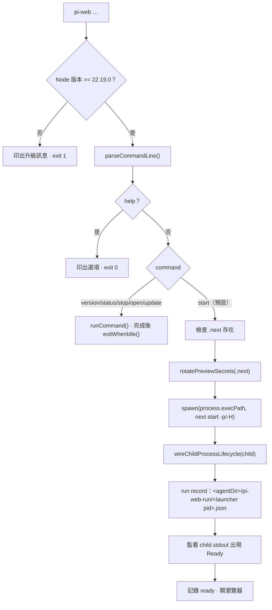
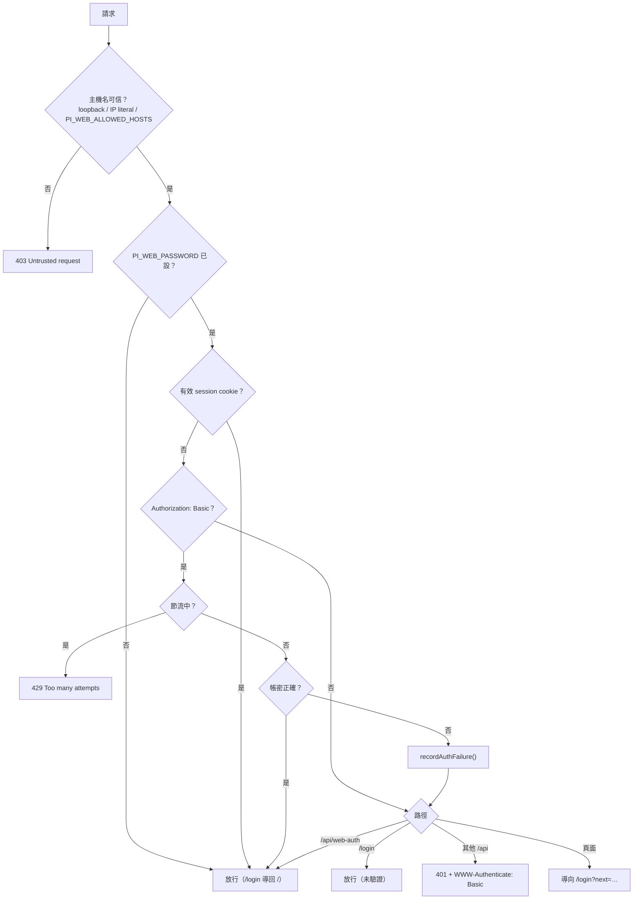
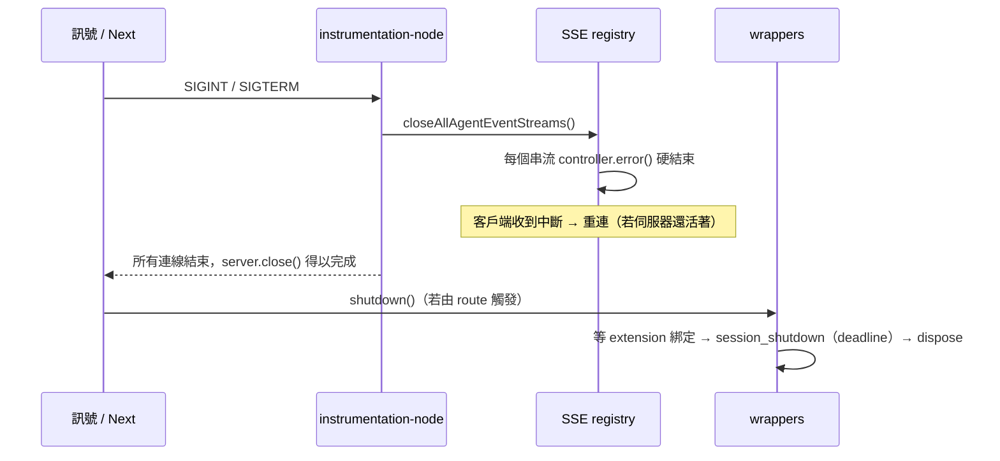

# 01 · 執行期：啟動、生命週期與串流

本篇說明「一個 Pi Web 行程從被執行到結束之間發生什麼事」：CLI 啟動器、Next 執行期、
AgentSession 的生命週期、SSE 串流，以及 session 檔案的讀取與快取。

---

## 1. CLI 啟動器（`bin/`）

`npx @agegr/pi-web` 或全域安裝的 `pi-web` 執行的是 `bin/pi-web.js`（CommonJS）。



重點：

- **選項解析**（`bin/pi-web-options.js`）：`--port/-p`（或 `PORT`）、`--hostname/-H`
  （或 `PI_WEB_HOSTNAME`）、`--no-open`（或 `PI_WEB_NO_OPEN=1`）、`--help/-h`。
  未知選項直接以錯誤結束。命令列選項優先於對應的環境變數。
- **子命令**（`bin/pi-web-commands.js`）：`version`、`status`（列出執行中的伺服器）、
  `stop [--port N]`、`open [--port N]`、`update [--check]`。這幾條不會啟動伺服器。
- **preview secret 輪替**（`bin/rotate-preview-secrets.js`）：npm 打包進去的
  `previewModeId` 必須在 `next start` 前換成隨機值，否則理論上可以用
  `x-prerender-revalidate` 這類標頭繞過 proxy。輪替失敗只警告，不阻止啟動。
- **直接呼叫 Next 的 JS 進入點**（`bin/pi-web-node-args.js`），不靠 `.bin` 符號連結，
  也避免 Windows 上含空白路徑配上 `shell: true` 的問題。
- **run record**：`<agentDir>/pi-web-run/<launcher pid>.json`，由啟動器寫入、
  行程結束時移除；`pi-web status/stop/open` 靠它找到其他行程。port 設成 `0` 時不記錄。
- **`exitWhenIdle()`**：不以 `process.exit()` 立刻結束，而是讓事件迴圈自然排空
  （最多 2 秒的 unref'd timer）。這是為了避開 Windows 上 Node 23～24.19/26.6
  在 fetch 尚未收尾時中止會觸發的 libuv 斷言（`UV_HANDLE_CLOSING`）。
- **`bin/prepare-terminal.js`**（`postinstall`）：修補 node-pty 在 macOS 的
  spawn-helper 執行權限。終端機的 native 模組延後到真的開終端機時才載入，
  載入失敗會回 JSON 錯誤與修復說明（見 [`docs/terminal.md`](../terminal.md)）。

### 環境變數一覽

| 變數 | 作用 | 預設 |
| --- | --- | --- |
| `PORT` / `PI_WEB_HOSTNAME` | 連接埠 / 綁定主機 | `30141` / `127.0.0.1` |
| `PI_WEB_NO_OPEN` | 不自動開瀏覽器 | 未設 |
| `PI_WEB_APP_NAME` | PWA manifest 的名稱 | `Pi Web` |
| `PI_WEB_ALLOWED_HOSTS` | 額外允許的代理／自訂主機名（逗號分隔） | 未設 |
| `PI_WEB_PASSWORD` | 啟用瀏覽器密碼登入（API 可用 Basic，帳號 `pi`） | 關閉 |
| `PI_WEB_IDLE_TIMEOUT_MS` | session 閒置回收毫秒數，`0` 停用 | `600000`（10 分） |
| `PI_WEB_SHUTDOWN_DEADLINE_MS` | 給 extension 處理 `session_shutdown` 的期限 | `5000` |
| `PI_WEB_MCP_IDLE_MS` | MCP 連線在最後一次 prompt 後保留多久，`0` 停用 | `600000` |
| `PI_WEB_DISABLE_MCP` | 非空、非 `0`/`false` 時停用 MCP | 未設 |
| `PI_WEB_SSE_BACKLOG_LIMIT_BYTES` | SSE 佇列上限（≥64 KiB 才生效） | 16 MiB |
| `PI_WEB_SKIP_VERSION_CHECK` | 停用版本更新檢查 | 未設 |
| `PI_CODING_AGENT_DIR` | 覆寫 pi agent 目錄 | `~/.pi/agent` |
| `HTTP_PROXY` / `HTTPS_PROXY` / `NO_PROXY` | 伺服器端模型與 API 請求的代理 | 未設 |

---

## 2. Next 執行期

### 2.1 中介層 `proxy.ts`

`proxy.ts` 是所有請求的第一道關卡（matcher：`/`、`/login`、`/api/:path*`）：



- **主機名檢查**同時擋掉 DNS rebinding：只信 loopback、IP 字面值，或 operator
  明確列在 `PI_WEB_ALLOWED_HOSTS` / `PI_WEB_HOSTNAME` 的名稱。
- **API 的來源檢查**另外看 `Origin` / `Sec-Fetch-Site`（`lib/request-security.ts`）。
  非瀏覽器用戶端（沒有這兩個標頭）照常放行；跨站一律拒絕。
  有一個例外：使用者主動點擊導覽到 `/api/sessions/[id]/export`（`sec-fetch-mode: navigate`
  + `sec-fetch-dest: document` + `sec-fetch-user: ?1`）允許，讓「匯出」能以連結方式開啟。
- **節流**（`lib/auth-throttle.ts`）：刻意做成**全域**而非 per-IP。失敗會讓所有人的
  等待時間加倍（1 秒 → 上限 60 秒）；成功或閒置 5 分鐘才重置。重置視窗必須長於最大延遲，
  否則「等過一次封鎖」就等於重新開始爆破。狀態放在
  `globalThis[Symbol.for("pi-web:auth-throttle")]`，`proxy.ts` 與 route handlers 共用。
- **Basic 成功不會重置計數器**：Basic 客戶端每個請求都帶帳密，若成功就重置，
  交錯嘗試的攻擊者每次都能拿到新的短封鎖。被擋住時即使密碼正確也回 429。

### 2.2 啟動掛鉤 `instrumentation.ts` → `instrumentation-node.ts`

Next 會為 Node 與 Edge 兩種執行期各建一份；Edge 圖不接受 Node API，所以用
**編譯期可消除的 `process.env.NEXT_RUNTIME === "nodejs"` 分支**匯入 Node 專屬檔案
（不是 early return，否則 Node 呼叫會留在 Edge 模組裡）。Node 掛鉤做三件事：

1. `configureHttpDispatcher(readHttpIdleTimeoutMs())` —— 讓 undici 的 body/header
   逾時跟 pi CLI 一樣吃 `settings.json` 的 `httpIdleTimeoutMs`。否則內建 5 分鐘會中斷
   安靜較久的供應商串流。
2. `SIGINT`/`SIGTERM` 時 `closeAllAgentEventStreams()` —— 正式模式下 Next 16 收到
   訊號會 `server.close()` 並等所有連線結束、沒有逾時；SSE 只有在客戶端斷線時才結束，
   不主動關就永遠不退出。
3. 非同步 `import("@earendil-works/pi-coding-agent")` —— 讓第一次 `/api/sessions`
   不必現付整個 SDK 的載入成本（Windows 上可達數秒）。失敗留給 route 自己回報。

### 2.3 `next.config.ts`

- `proxyClientMaxBodySize: "128mb"` —— `proxy.ts` 存在時 Next 會緩衝請求主體，
  預設 10 MB；上傳路由允許 100 MB，不調高會被截斷成 `Failed to parse body as FormData.`。
- `images.unoptimized: true` —— 只用 `next/image` 顯示靜態 logo，不需要
  `/_next/image` 優化器與它的攻擊面。
- **GFM email regex loader**：`mdast-util-gfm-autolink-literal`（remark-gfm）內含
  RegExp lookbehind，Safari 16.2 無法解析會讓 `/` 變空白頁。`lib/gfm-autolink-email-loader.cjs`
  在兩個 bundler（Turbopack 的 `turbopack.rules` 與 webpack 的 `module.rules`）都掛上，
  把該 regex 換成執行期等價寫法；上游改動時 loader 會直接讓建置失敗。
- `transpilePackages: ["mermaid", "@mermaid-js/parser"]` —— 這兩個套件帶著 class
  `static {}` 區塊，需要被降級。
- `serverExternalPackages`：`node-pty`、`undici`、`web-push` 與四個 `@earendil-works/*`。
- `allowedDevOrigins`：loopback 與 RFC1918 網段，讓 dev server 可從同網段其他機器連。
- `headers()`：`/` 不快取、`/sw.js` 與 manifest 不快取但允許 Service Worker 範圍 `/`。
- `env`：`NEXT_PUBLIC_APP_VERSION`（package.json 版本）與
  `NEXT_PUBLIC_PI_VERSION`（`@earendil-works/pi-coding-agent` 版本），供品牌彩蛋使用。

### 2.4 route 慣例

`app/api/**/route.ts` 是 Next App Router 的 handler。共通規則：

- 動態資料的路由標 `export const dynamic = "force-dynamic"`，回應帶
  `Cache-Control: no-store`（少數刻意長快取的例外見 01 §5）。
- 請求格式檢查用 `hasJsonContentType()`（`application/json` 或 `+json`）。
- 錯誤一律 JSON：`{ error: string }`，需要時再加 `reason` / `code` 這類可對應
  i18n 的欄位（例如 `reason: "project-untrusted"`、`code: "prompt_rejected"`）。
- 多數路由只接受 POST/PUT/PATCH 的 JSON；`GET` 用 query string。

---

## 3. AgentSession 的生命週期（`lib/rpc-manager.ts`）

這是整個伺服器的心臟：2691 行，負責把 pi 的 `AgentSession` 包成可被 HTTP 與 SSE
反覆存取的物件。

### 3.1 註冊表與啟動

- 一個 session id 一個 `AgentSessionWrapper`，存在
  `globalThis.__piSessions`（**用 globalThis，不用模組層級 Map**：Next hot reload
  會重新求值模組，模組層級的 Map 會消失）。
- 併發的 `startRpcSession()` 共用同一個啟動 Promise（`globalThis.__piStartLocks`），
  所以同時開兩個分頁指向同一 session 不會建兩個 runtime。
- **啟動鎖的 key 必須唯一**：`/api/agent/new` 用 `` `__new__${randomUUID()}` ``，
  不能用 `Date.now()`（同毫秒的兩個新 session 會被合併成一個）。

`startRpcSession(sessionId, sessionFile, cwd, options)` 流程：

1. 解析**工具選擇**（preset 的 `toolNames`）與 **Chat only** 判定，
   在建立 services **之前**決定（Chat only 不能載入任何 session extension）。
2. 解析 **model scope**（`enabledModels`）與初始模型、thinking level、`scopedModels`，
   原子地套用。
3. 建立 pi services 與 `AgentSession`，附上：built-in extensions、
   per-session `McpHost`、subagent controller、project command shell、
   exact system prompt 工廠、read-only MCP policy。
4. 包成 `AgentSessionWrapper` 並註冊；回傳 `{ session, realSessionId }`。

`cwd` 不存在時：session 仍可開啟（讀歷史、開事件流），但 `prompt` 會被拒絕，
訊息是 `Directory does not exist: <cwd>`，回應帶 `code: "prompt_rejected", accepted: false`。

### 3.2 存活與回收

| 機制 | 觸發 | 行為 |
| --- | --- | --- |
| **idle 逾時** | 每次非 idle 活動後重設計時 | `PI_WEB_IDLE_TIMEOUT_MS`（預設 10 分）後 `shutdown()` |
| **Stop 後的強制回收** | `abort` / `abort_bash` | 設 `forceShutdownOnIdle` 並武裝計時器；之後的指令（reload、再次 Stop）**不得**把期限往後推 |
| **磁碟超前驅逐** | `evictIfDiskAhead()` | 檔案有記憶體索引沒見過的 entry（另一個 pi 行程 append 過）→ destroy 這個 wrapper |
| **liveness lease** | SSE 連線建立時自動註冊；`POST /api/agent/[id]/lease` 續租 | 有 detached 工作的 extension 可阻止自動驅逐（見下方 API） |
| **明確關閉** | `DELETE /api/sessions/[id]`、專案重建、`/api/project-trust` 重建 wrapper | 立即 `shutdown()` |

`shutdown()` 與 `destroy()` 一啟動，`isAlive()` **立刻**變 false：從那一刻起 route
不再把指令送給它，但 SDK session 在 `destroy()` 之前仍可用。`startRpcSession()`
要等前一個 wrapper 真的 dispose 完才會建新的（`closingRpcSessionWait()`，
最多 shutdown deadline + 1 秒）。

**shutdown 的順序**：先等 extension 綁定（無期限）→ 廣播 `session_shutdown`，
給 `PI_WEB_SHUTDOWN_DEADLINE_MS`（預設 5 秒）→ 無論如何都 dispose。
`McpHost.dispose()` 在 extension 聽到 `session_shutdown` **之前**就執行
（MCP 連線的關閉沒有上限，不能讓它拖住整個關機）。

**Stop 的難題**：`inner.abort()` 對於忽略 abort signal 的 await（第三方 extension
handler 或工具）永遠不會返回。所以 Stop 不是等待，而是「設定強制回收 + 武裝計時器」，
即使那個 run 還在跑，也會在一個 idle 逾時後被回收。

### 3.3 `send(command)`：命令分派

所有對 session 的操作都走同一個 JSON 命令介面（`POST /api/agent/[id]`）。
`send()` 會依 `type` 分派，且只有 `prompt` 需要 **prompt 准入**
（`promptAdmissionTail`）與 MCP 準備。

命令一覽（`lib/rpc-manager.ts` 的 `switch`）：

| 類別 | 命令 |
| --- | --- |
| 回合 | `prompt`、`steer`、`follow_up`、`abort`、`clear_queue` |
| 模型 / 思考 | `set_model`、`set_thinking_level` |
| 分支 / 複製 | `fork`（新檔）、`fork_branch`、`clone`、`navigate_tree` |
| 壓縮 | `compact`、`abort_compaction` |
| 工具 | `get_tools`、`set_tools`、`reload` |
| 資訊 | `get_state`、`get_commands`、`get_session_stats`、`get_last_assistant_text` |
| 設定 | `set_session_name`、`set_auto_compaction`、`set_auto_retry` |
| Shell | `bash`、`abort_bash` |
| Extension UI | `extension_ui_response`、`extension_ui_input` |

**`fork` / `fork_branch` / `clone` 絕不透過 `AgentSession.fork()`**：
那會就地替換 session（`inner.sessionId` 變成新的，並先中止目前的 run），
舊 id 底下的 wrapper 就會服務到新的狀態、破壞 `parentSession` 鏈。做法是另開一個
`SessionManager` 讀來源檔、`createBranchedSession()`，所以**來源在跑也能 fork**
（只有正在跑的 `!` shell 指令會被拒絕）。`clone` 則拒絕 running 的 session。

`reload` 在 session 執行中會被拒絕——它會讓 extension runner 失效，而正在跑的回合
仍握著舊的 `ctx`，下一個 hook 就會以 "This extension ctx is stale…" 掛掉。

### 3.4 對外暴露的執行期資訊

`GET /api/agent/running` 每 2.5 秒被側邊欄輪詢，回傳：

- `sessionListVersion` —— 清單快取世代；外部行程新增/刪除檔案時會變。
- `runningSessionIds` —— 有 run 在跑（含排隊中的 prompt、壓縮、bash）。
- `awaitingInputSessionIds` —— 正在跑，且卡在未回答的**阻塞式** extension UI
  請求（select / confirm / input / editor，或尚未關閉的自訂 overlay）。
  側邊欄用琥珀色呼吸點表示。
- `completionNotificationSuppressedSessionIds` —— 已被父層收走結果的背景 subagent，
  不再推播完成通知。
- `sessionUiStateRevision` —— 釘選/封存/專案順序的修訂號；未變動時只需一次 `statSync`。

`GET /api/agent/[id]` 回傳 `{ running, state }`；`state` 內含 extension 狀態列、
widgets、slash 命令等，是重新載入後恢復畫面的來源。

### 3.5 Session liveness lease（讓 extension 阻止自動驅逐）

伺服器端的 pi extension 若有 detached 工作，可透過版本化的全域註冊表阻止 idle 回收：

```js
const liveness = globalThis[Symbol.for("@agegr/pi-web/session-liveness/v1")];
const release = liveness?.version === 1
  ? liveness.register({
      name: "my-extension",
      sessionId,
      sessionFile: sessionFile || undefined,
      isActive: () => detachedJobs.size > 0,
    })
  : () => {};
```

`isActive` 必須同步、便宜，且只對給定的 session id 或檔案生效。provider 出錯時
**fail safe（保留該 session）**。這個 lease 只影響自動 idle 驅逐；明確關閉與
Stop 的強制回收仍然優先。Pi Web 自己的 SSE 串流也會自動註冊 lease，並以
`POST /api/agent/[id]/lease` 續租。

---

## 4. SSE 串流（`lib/agent-event-stream.ts`）

`GET /api/agent/[id]/events` 回傳 `text/event-stream`。實作要同時應付三個現實：

**（a）先開傳輸，後發布快照。**
先把 response header 送出去（一個 `:` 註解心跳），等到 agent ready、事件監聽器裝好，
才送 `connected` 事件、緩衝事件、以及目前串流中的訊息（`message_start`）。
客戶端是等到 `connected` 才認為串流可用。

**（b）背壓。** 客戶端常常是手機：螢幕關了、分頁背景化、網路不穩就不再讀取，
而每個排進佇列的事件都會留在伺服器記憶體裡（曾經有一個 24 MB 指令的輸出，
在客戶端停止讀取後留下 22.7 MB 排隊，且那份記憶體要等 GC 才回來）。

- `highWaterMark` = 512 KiB。
- 超過高水位時，**可重建的事件**被丟棄：`message_update` 的 `*_delta`（其 `*_end`
  會帶權威內容覆蓋）、`tool_execution_update`（整個 partial result，下一次更新取代）。
  `*_start` / `*_end` 絕不丟，因為客戶端的 reducer 靠它們建立與結束區塊。
- 超過 `PI_WEB_SSE_BACKLOG_LIMIT_BYTES`（預設 16 MiB）則**直接以 error 結束串流**，
  讓客戶端重連並重新取快照。刻意不用 graceful close：那會留下仍 ESTABLISHED 的 socket，
  讓 Next 的 `server.close()` 永遠等不到 drain。
- 影像讀取的 base64 在 `message_end` 才送（它的 `message_start` 只送 `role`），
  這也是為什麼上限必須容納健康客戶端在慢速網路上的在途資料。

**（c）合併與去重。**

- `tool_execution_update` 依 `toolCallId` 合併（`TOOL_UPDATE_COALESCE_MS = 150` ms，
  最新者勝）。該 id 的待送更新會在轉送它的 `tool_execution_end` 前丟棄，
  `agent_end` 則清空全部——否則工具會在客戶端看起來又開始跑。
- 心跳每 30 秒一個 `:` 註解。
- `lib/agent-event-wire.ts` 的 `toClientAgentEvent()` 做瘦身與篩選：
  - `tool_execution_end` **不帶** `result`（bash 輸出可達 1 MiB），由後續的
    toolResult 訊息渲染。
  - 非 assistant 的 `message_start` 只送 `{ role }`。
  - transcript 的 `system` 訊息（含每個 tool schema）一律丟棄。
  - 巢狀（`ctx.executeTool()`）事件：start/end 精簡送出並帶 `parentToolCallId`，
    update 丟棄；判斷嵌套要在重建 update **之前**做。
- `session_shutdown` 會結束串流（`cleanup(true)`）；啟動失敗送
  `startup_error` 後關閉。
- 所有活躍串流登記在 `globalThis[Symbol.for("pi-web.agentEventStreamClosers")]`
  （`instrumentation` 與 route 是不同 bundle，模組層級 Set 會變成兩份），
  供程序關機時統一關閉。

客戶端（`hooks/useAgentSession.ts`）的策略：SSE 為主，每個 prompt 前確保連線；
`prompt_done` 同時完成 UI 階段與通知（被停止的 run 不播完成音）；
選取中的 session 串流保持開啟，其他 session 有 30 秒寬限期；
`agent_start` 取消關閉計時器；`agent_settled` 收尾沒有 wrapper 級 `prompt_done`
的 extension 注入回合。執行中會輪詢 `GET /api/agent/[id]` 並在
`visibilitychange` / `online` 時對帳，補上背景分頁或半開連線漏掉的事件。

---

## 5. Session 檔案與讀取

### 5.1 檔案格式

位置：`~/.pi/agent/sessions/<encoded-cwd>/<timestamp>_<uuid>.jsonl`，
一行一個 entry。`lib/types.ts` 有完整的型別。常見的 `type`：

```jsonl
{"type":"session","version":3,"id":"<uuid>","timestamp":"…","cwd":"/path","parentSession":"/abs/parent.jsonl"}
{"type":"message","id":"<8hex>","parentId":null,"message":{"role":"user","content":"…"}}
{"type":"message","id":"…","parentId":"…","message":{"role":"assistant","content":[…],"usage":{…},"durationMs":…}}
{"type":"message","id":"…","parentId":"…","message":{"role":"toolResult","toolCallId":"…","content":[…],"details":{…}}}
{"type":"compaction","id":"…","parentId":"…","summary":"…","firstKeptEntryId":"…","tokensBefore":N}
{"type":"session_info","id":"…","parentId":"…","name":"使用者命名"}
{"type":"custom","customType":"pi-web:tool-selection","data":{"version":1,"tools":[]}}
{"type":"usage","kind":"cache_warm","…"}
{"type":"context_edit","…"}
```

- `SessionContext.entryIds[]` 與 `messages[]` 平行，是 fork 與 `navigate_tree` 的依據。
- **`parentSession` 只是顯示用 metadata**，所以整檔重寫是安全的
  （pi 自己在 migration 也這樣做），刪除時的串接重指也靠這點。
- `custom` 訊息若 `display: false` 只給模型看，前端不渲染（也不佔 turn 分組）。
- transcript 的 `system` 訊息是 provider 輸入而非對話，UI 一律忽略。

### 5.2 讀取層（`lib/session-reader.ts`）

- 包裝 SDK 的 `SessionManager`，並維護 **path cache**（id → 檔案路徑）。
- `listAllSessions()` / `listSessionSummaries()` / `mergeSessionLists()`：
  `summary=1` 只讀每個檔的 header 與 stat（側邊欄可以先畫），完整清單另外解析。
- 清單快取 TTL 30 秒（`SESSION_LIST_CACHE_TTL_MS`），並用 **generation** 判斷新鮮度：
  `invalidateSessionListCache()` 只推進世代、**保留**上一次掃描結果；
  只要 metadata 的呼叫端可傳 `allowStale: true` 先讀舊值、背景重建。
- `normalizeToolCalls()`（`lib/normalize.ts`）：pi 存的是
  `{ type:"toolCall", id, name, arguments }`，前端型別是
  `{ toolCallId, toolName, input }`；檔案載入與串流兩邊都要轉。

### 5.3 增量掃描（`lib/session-list-scanner.ts`）

- 掃描結果是**增量索引**：同一檔案在 size 與 mtime 不變時回傳**同一個 row 物件**
  （因此可以用 `WeakMap` 依 row 快取 subagent 的 run 讀取）。355 個 session
  （137 個 subagent）的重建從 36 ms 降到 7 ms——這些都是會阻塞事件迴圈的同步讀取。
- 只讀檔案開頭 64 KiB（`SUMMARY_HEADER_MAX_BYTES`）就能拿到 header 與首則訊息。
- **外部檔案變動偵測**：pi CLI（或其他行程）新增/刪除 session 不會推進
  `sessionListVersion`，而清單快取的 30 秒只在「有人要清單」時才被檢查，
  所以側邊欄的輪詢永遠不會因為它們而重載。`getSessionListVersion()`
  （輪詢每 2.5 秒呼叫）因此附帶一個檔名檢查：列出
  `sessions/<cwd>/*.jsonl`（只讀目錄，不開任何 transcript），集合與上次不同就
  invalidate。一次只跑一個檢查、每秒最多一次（`SESSION_MEMBERSHIP_CHECK_MS`）。
  不用 `fs.watch`：Linux 上遞迴 watch 是 Node 的 JS 層（每個檔案/資料夾一個 inotify，
  啟動時同步走完整棵樹，且達到 inotify 上限後會**默默變成部分監看**），macOS 上
  append 會被回報成 `rename`。成本是「有分頁在輪詢時，每個專案資料夾每秒一次 readdir」。

### 5.4 快取

- **tool result 影像**：`GET /api/sessions/[id]/entries/[entryId]/tool-result-image?blockIndex=`
  回 `private, max-age=31536000, immutable`。entry id + block index 永久指向同一份位元組
  （pi 只 append；migration 的重寫保留所有 entry id；`context_edit` 不動原始歷史）。
- **session 檢視快取**（`lib/session-view-cache.ts`）：儲存時量一次大小
  （`JSON.stringify` 長度），之後依儲存大小汰換；快照**永不就地修改**。
- **`GET /api/sessions/[id]/state`**：執行中 wrapper 的即時狀態（供重新載入後接回）。

### 5.5 其他 session 相關路由

`GET /api/sessions/[id]` 讀檔或以 wrapper 的記憶體 `SessionManager` 為準；
`GET /api/sessions/[id]/context` 分頁一個 leaf 的上下文（`tail` 預設 50，`before` 往上翻頁）；
`GET /api/sessions/[id]/entries/[entryId]/thinking` 取單一 thinking 區塊；
`POST /api/sessions/[id]/fork` 在磁碟上複製分支（不建 runtime，見 03 與下方）；
`GET /api/sessions/search` 以使用者與 assistant 訊息為索引。

---

## 6. 行程結束



- terminal 的 shell 在伺服器關機時**立即**強制 kill。
- 明確終止或到期會先送 SIGHUP，兩秒後升級 SIGKILL。
