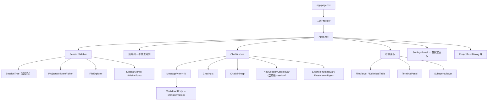
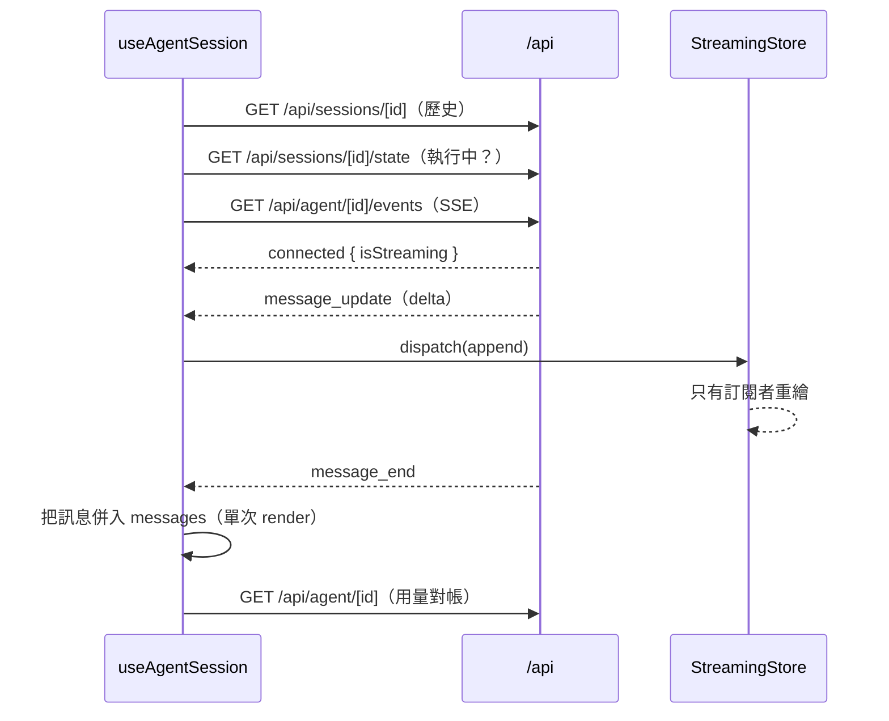

# 03 · 前端：AppShell、串流、側邊欄與面板

整份 UI 在用戶端渲染：`app/page.tsx` → `Suspense` → `I18nProvider` → `AppShell`。
`app/layout.tsx` 只放 `<head>`（主題初始化 script，避免閃爍）、PWA 註冊與全域 CSS。



全域 CSS：`app/globals.css`（版面、聊天、面板）、`app/settings.css`、
`app/sidebar.css`、`app/sidebar-menu.css`。CSS 變數集中在
`--bg`、`--bg-panel`、`--bg-hover`、`--bg-selected`、`--border`、`--text`、
`--text-muted`、`--text-dim`、`--accent`、`--user-bg`、`--tool-bg`、`--font-mono`。

---

## 1. AppShell：應用程式的協調者

`components/AppShell.tsx`（2791 行）擁有幾乎所有跨區域的狀態與副作用：

| 關注點 | 內容 |
| --- | --- |
| **URL 狀態** | `getInitialNavigation(searchParams)`：`?cwd=`、`?session=`、`?tab=`；`withTabOpen()` 讓每個 tab 記得自己開過的 session（`sessionStorage`）。 |
| **選取** | `selectedSession`（`selectedSessionRef` 是同步給非同步回呼用的版本）、`sessionCatalog`（側邊欄清單）、`activeCwd`。 |
| **執行狀態** | `runningSessionIds`、`awaitingInput`、`contextUsage`、`sessionStats`、`branchTree` / `branchActiveLeafId`（分支導覽）。 |
| **面板** | `activeTopPanel`（agents / branches / system / tools / session）、`settingsSection`、`projectTrust`、`searchTarget`。 |
| **右側 tab** | `fileTabs` / `activeFileTabId`、`terminalTabs`、`agentTabs`（subagent viewer）。檔案 tab 屬於**專案**（同專案的 worktree 共用），terminal tab 不屬於任何專案，subagent tab 在每次換專案時丟棄。 |
| **音效 / 通知** | `useAudio()` 由 AppShell 擁有（不是 ChatWindow），這樣「別的工作區」完成的任務也能發聲；Web Push 訂閱也在這裡註冊。 |
| **版面** | 側邊欄寬度、右側面板寬度（`useResizablePanel`，含響應式上限）、手機抽屜開關、`useViewportHeight`。 |

關鍵流程：

- **`handleCwdChange`** —— 側邊欄回報新的 cwd。專案切換時走 `changeFileWorkspace()`：
  把目前專案的檔案 tab（含 active tab 與是否顯示）**停放**在頁面記憶體，換上目標專案的；
  terminal tab 保持顯示。停放不含檔案內容，重新載入即消失。
- **`handleSelectSession` / `handleNewSession`** —— 後者第三個參數 `projectKey`
  讓「群組的 +」可以在 cwd 移動前就安裝專案身分（沒有它，`handleCwdChange`
  會把緊接下來的 cwd 報告當成身分 hydration，而保留前一專案的檔案 tab）。
- **`restoreWorkspaceContext()`** —— 重載後接回上次的 session；`?session=` 指向的
  session 不存在時會 `skipWorkspaceRestoreRef`，避免工作區記憶又把 URL 指的
  那個 session 叫回來。
- **刪除的競態**：DELETE 回應可能在使用者已經切走之後才到，所以
  `handleSessionDeleted` 讀的是 render 同步的 `selectedSessionRef.current`，
  而不是被捕捉的 state。
- **`handleAgentEnd` / `handleAttentionNeeded`** —— 回合結束重載清單、讀用量、播音；
  需要使用者輸入的阻塞式 extension 請求會跳瀏覽器通知。

### 焦點管理

跨元件的焦點規則散在幾處，但原則是「不要讓焦點掉到 `<body>`」：
`focusModalPanel()`（開啟的模態取得焦點、關閉時回到開啟者）、`focusIfLost()`、
`focusAfterChange()`、`focusIfHidden()`（把 `[inert]` 內或沒有 box 的焦點視為遺失，
因為 Chromium 對 inert 元素只在下一幀才 blur）。側邊欄另外用
`sidebarFocusRef` 記住焦點在哪個控制項，並在版面切換時把它交接過去。

---

## 2. `useAgentSession`：session 的用戶端大腦

`hooks/useAgentSession.ts`（2792 行）負責一個選取中 session 的所有互動。



要點：

- **SSE 為主**，每個 prompt 前確保連線。`prompt_done` 一次完成 UI 階段與通知；
  選取中的 session 串流保持開啟，其他 session 有 30 秒寬限；`agent_start` 取消關閉計時器；
  `agent_settled` 收尾沒有 `prompt_done` 的 extension 注入回合。
- **對帳**：執行中輪詢 `GET /api/agent/[id]`，並在 `visibilitychange` / `online` 時
  補上漏掉的事件。用量讀取（mount、串流連線、訊息完成、對帳、`agent_end`）
  共用單調遞增的請求 id，只有比上次更新者才套用，避免延遲的回應蓋掉新值。
- **執行 id**：每個 prompt run 有單調遞增 id；舊 run 遲到的 SSE 或對帳結果必須忽略，
  否則會復活已消失的串流泡泡。
- **Strict Mode**：所有 SSE (重)連線都受 `sessionHookMountedRef` 節制；
  dev 下 mount-only effect 的 cleanup 會清掉它，warm-session effect 必須重新斷言。
- **內建 slash 命令**：`/session` 開統計面板；裸 `/mcp` 在 pi 的內建 mcp 擁有它時
  開 Settings › MCP（其餘（含子命令）照常送出）。判斷「擁有者」會等正在跑的
  `get_commands`（`slashCommandsLoadRef`），不猜測——猜錯會吞掉別的 extension 的
  `/mcp`，或讓 host 白等 10 秒。
- **新 session 的第一次送出比 composer 活得久**：送出中切換 session 會 unmount hook
  並關掉它的串流，但 `handleSend` 仍會 POST prompt（unmount 後跳過等待串流）
  並把 session 升級到側邊欄。
- **`ensureNewSession()`** 建立一次性 wrapper（`type: "ensure_session"`）供模型選單、
  System / Tools 面板查詢命令與工具；cwd 不存在時把伺服器的 `error` 原樣傳出。

---

## 3. 串流訊息：不讓每個 chunk 重繪整個畫面

這是效能上最重要的一組設計。

### 3.1 `StreamingStore`（`lib/streaming-message.ts`、`hooks/useStreamingSelector.ts`）

串流中的訊息**不放在 `useAgentSession` 的 state**。放在 state 的話，每個 chunk 都會
重繪 ChatWindow、hook 與整個 composer（`ChatInput`、`ModelSelector`）：
在 4 倍 CPU 節流下，一個 40 秒的回覆約有 500 ms 花在 commit，而 `ChatInput` 的 props
在 555 次 render 中有 543 次沒變。

- `ChatWindow` 只訂閱「有沒有在串流、有沒有內容」。
- `StreamingReply` 訂閱訊息本身，並在每個 chunk commit 後更新 prompt 錨點。
- `ChatMinimap` 在量測 turns 時用 `getStreamingMessage()` 讀一次。
- `useStreamingSelector()` 用 **state 更新**訂閱，而不是 `useSyncExternalStore`：
  後者每個 chunk 各自 render，前者讓 React 把先到的 SSE 事件批次處理。
  store 在 `dispatch` 中**同步**呼叫 listener，所以 `message_end`
  附加回覆與結束串流是同一次 render。
- `ChatInput` 與 `ChatMinimap` 也是 `memo`，它們的 props 必須在 ChatWindow
  重繪之間保持 identity。

### 3.2 逐塊渲染 Markdown（`components/MarkdownBody.tsx`、`lib/markdown-blocks.ts`）

串流回覆每個 chunk 只長幾個字元，但每 chunk 重新解析整份回覆會讓長回覆變成二次成本
（4 倍節流下，14k 字元的回覆花 8.8 s 在 react-markdown，commit 從 5 ms 長到 16 ms）。

`isStreaming` 時 `MarkdownBody` 用 `splitMarkdownBlocks()` 切塊，每塊渲染一個
`memo` 的 `MarkdownBlock`，所以**已完成的區塊保留自己的解析結果**，只有最後一塊重解析。
切點只在空行後、行首第 0 欄且不是清單項；**絕不**切在 code fence 或 `$$` 區塊內，
也不切在文件最前面有 front matter、或第一個含 HTML 標籤的行之後。
`lib/markdown-blocks.test.mjs` 檢查「任何前綴切出來的塊」與「全文切出來的塊」一致。

### 3.3 訊息模型與 turn 分組（`components/ChatWindow.tsx`、`lib/message-display.ts`、`lib/turn-views.ts`）

- 一個 **turn** 從一個錨點到下一個錨點；錨點是：使用者訊息、壓縮摘要、
  以及背景 subagent 完成通知（否則對通知的回覆會變成該 turn 的答案，
  真正的答案被摺進 Process details）。
- turn 的最後一個 assistant 回覆顯示，之前的一切摺進「Process details」。
- **Process details 的初始狀態**取決於它下面顯示的答案有沒有文字或圖片；
  只以錯誤/截斷通知結尾的 turn 保持展開（`collapsesProcessDetails()`）。
- **`display: false` 的 custom 訊息**留在 `messages` / `entryIds` 但不渲染
  （extension 可能在每次 `session_start` 都送一則），也不佔 Process details 的計數，
  也不當錨點。
- **Props 穩定**：`MessageView` 與 `MarkdownBody` 是 `memo`，所以
  `toolResultsMap` 有 memo、群組 turn 的答案與製檔清單來自
  `getFinalAnswerViews()` / `keepWrittenFiles()`（依 stored message 快取）。
  內聯建構的副本會在每個按鍵重跑所有可見答案的 markdown。

### 3.4 其他渲染細節

- **工具卡時間**用 result 的 `durationMs`（pi 1.1 以單調時鐘量測並存進 session 檔），
  格式與 CLI 的 "Took" 一致，低於 100 ms 不顯示；舊資料退回
  「結果時間戳 − assistant 訊息時間戳」（後者是該請求**開始**的時間，所以也含生成時間）。
- **Compaction summary 卡**預設摺疊（與 pi TUI 一致），標題本身是切換鈕，
  Markdown 與檔案清單只在展開時 mount。
- **串流 token 速率**的起點存在 `lib/stream-token-rate.ts`，以回覆
  （provider、model、請求 `timestamp`）為 key，而不是存在 `MessageView`：
  切換 session 會 remount 對話，起點若在 remount 時取，會把先前所有 token
  除以不到一秒。
- **自動重試橫幅**：`auto_retry_start` 顯示「Retrying (n/max)…」，
  下一次 run 的 `agent_start` 清掉它。
- **程式碼高亮**：`lib/highlight-queue.ts` 在一個任務內先高亮前 2,000 字元的 fence，
  其餘先用 `text` 渲染（同樣的行號與外框），每個 idle 切片補一種語言、最新優先。
  `lib/prism-languages.ts` 讓 Prism 語言**按需載入**：`CodeBlock` 與 `FileViewer`
  用 `react-syntax-highlighter/dist/esm/prism-light`，第一次 mount 時才把
  `refractor/all` 當成獨立 chunk 載入（它註冊約 300 種語言，約 650 ms）。
  高亮過的 fence 要看 `span.token`（排除 `.linenumber`），不是 `language-*` class。
- **Mermaid** 圖表在 `components/MermaidBlock.tsx` 獨立 lazy chunk（並列在
  `transpilePackages`）。
- **ANSI** 輸出用 `components/AnsiText.tsx`；DOCX 用 `mammoth`、PDF 由瀏覽器原生顯示、
  CSV/TSV 走 `DelimitedTable`。

---

## 4. 側邊欄

側邊欄有**兩種版面，同一棵 element tree**（`stacked = !isMobile && placement === "below"`）：

- **併排（下方）**：品牌 + 工具列，sessions 面板在上，可調整高度的 files 區塊在下。
- **分頁**：`Sessions | Files` 兩張 tab（兩張都保持 mounted，未作用者 `hidden`）。
  手機一律用分頁（`useFilesPlacement()` 的伺服器快照也是分頁）。

切換**不會 remount** `FileExplorer`（展開的資料夾、搜尋、上傳都要活著）、
session tree（捲動位置）或 picker。`useSidebarMotion()` 負責封存檢視與 files 折疊的
進出動畫，並在 `prefers-reduced-motion` 下整個不啟用。

### 4.1 Sidebar 的伺服器端狀態（釘選 / 封存 / 專案順序）

放在 `<agentDir>/pi-web-session-state.json`，**絕不寫進 `.jsonl`**。理由：
自訂 entry 會推進 leaf（產生幽靈分支出現）、讓閒置 wrapper 的 `evictIfDiskAhead()`
把它丟掉，而且會被每個 fork 複製；把檔案搬進 archive 資料夾又會弄壞子 session 的
絕對 `parentSession` 路徑；localStorage 則只在單一瀏覽器有效，而一個伺服器服務多個。

```jsonc
{
  "version": 1,
  "revision": 12,
  "sessions": { "<family root id>": { "pinnedAt": 0, "archivedAt": 0 } },
  "projects": { "<projectKey>": { "pinnedAt": 0, "root": "/path" } },
  "projectOrder": ["<projectKey>", "…"],   // 空的時候不存在
  "projectNames": { "<projectKey>": "名稱" } // 空的時候不存在
}
```

- **`POST /api/sessions/ui-state`** 只接受一種請求：
  `set`（`ids` + 恰好一個 `pinned` / `archived`，上限 500 個 id）、
  `restore`（還原先前值，Undo）、`pin-project`、`add-projects`（`keys`）、
  `move-project`（`projectKey`、`anchorKey`、`position`、`add`）、
  `rename-project`（`name: string | null`）。大批變更（一次封存很多 + Undo）
  以每批 500 個排隊送出，被拒的那批只回滾自己。
- **`applySessionUiStateRequest()` 為前後端共用**，所以前端的樂觀套用結果
  與伺服器完全一致：釘選與封存互斥、重複封存更新 `archivedAt`、
  重複釘選保留 `pinnedAt`、清空的項目會被刪除。
- **專案順序是一份清單服務兩個帶狀區**（釘選專案、其餘專案），各自照清單順序顯示。
  沒有人會整份覆寫，所以多視窗不會互相蓋掉：`add-projects` 把清單缺少的 key
  依序插到最前面（idempotent）；`move-project` 先同樣加入 `add`，再把目標
  放到 `anchorKey` 前/後。上限 1000 個 key / 256 KiB。
- **`revision`** 只在寫入真的有變化時推進。寫入順序：行程內
  `serializeByKey()` → 跨行程 `proper-lockfile`（約 3 秒重試，之後 409 `locked`）
  → `writePrivateFileAtomicSync()`（0600）。無法解析的檔案讀成空的且**永不覆寫**：
  下一次寫入會把它改名成 `.corrupt-<ms>` 再從空的開始，revision 仍繼續前進。
- **跨瀏覽器同步**：`GET /api/agent/running` 帶 `sessionUiStateRevision`
  （檔案未變時只需一次 `statSync`），側邊欄的輪詢把它交給 `noteRevision()`，
  不同且沒有排隊中的寫入時就重新 GET。
- **封存判定**（`isFamilyArchived()`）：`archivedAt` 已設、家族裡沒有成員在跑，
  且 `archivedAt >= Date.parse(root.modified)`。`root.modified` 是**最後一則
  使用者/assistant 訊息**的時間，所以新訊息會讓家族自己回來（包含從 pi CLI
  送出的）；絕不使用 `family.latestModified`（只有 subagent 活動不該解除封存）。

### 4.2 SessionTree（`lib/session-tree.ts`、`components/SessionTree.tsx`）

`buildSessionTree()` 是純函式，產生扁平的 `rows`，`SessionTree` 依每種 row 的高度
虛擬化。

- 第一段是 **Pinned**（各專案的釘選家族，最新的釘選在前，預設顯示 8 個 + show more），
  接著每個專案一個可摺疊群組：有非釘選家族的專案、目前專案（即使空的）、
  被釘選的專案。群組預設展開 6 個最新家族，外加任何「在跑 / 未讀 / 被選取」的家族，
  然後是「show more · N」（每次多 20 個，永遠不會一次全部 mount）。
- **三種文字顏色**：內容（session 標題）`--text`、標籤（專案名、區段名）`--text-muted`、
  其餘（時間、計數、分支、釘選列的專案、「show more」、footer）`--text-dim`。
  `SessionTree.test.mjs` 會列舉 `app/sidebar.css` 裡每一個 `color:` 來守住這條規則。
- **清單裡沒有 icon**（沒有資料夾、沒有釘選圖示）：只有 chevron、釘選專案的小圖釘、
  列內的分支 icon、footer 的兩個。
- **兩條對齊線**：chevron 欄（內縮 + 11px）與文字欄（內縮 + 26px）。
- **高度**：session 列、每一種 header、空群組提示、footer 兩條連結都是 28px
  （手機 44px，手指最小值）；只有「show more」矮一階（26px / 36px）。
- 右欄依序顯示：等待輸入的琥珀呼吸點 → 執行中的 spinner → 未讀點 → 短時間。
- 選取列有左緣 3px 的 accent 條；accent 永遠代表「狀態」，不代表標籤。
- **虛擬化的 scrollbar 寬度**會量進 `--session-tree-scrollbar`，讓列的右內縮跟著調整。
- **Row key 唯一且穩定**：`session:<context>:<rootId>`、`group:<key>`、`more:<key>`、
  `empty:<key>`，以及固定 key；焦點追蹤與 `keepMounted` 都靠它們。
- 選單（`SidebarMenu`）與 toast 掛在虛擬列之上，所以捲走的列仍保有開啟中的選單；
  menu 會 portal 到 `document.body`（手機抽屜的 `transform` 會把 `position: fixed`
  釘在抽屜上）。

### 4.3 前端偏好（per-browser）

| localStorage key | 內容 |
| --- | --- |
| `pi-locale` | 語言（`en` / `zh-CN` / `zh-TW`） |
| `pi-theme` | 主題（`auto` / `light` / `dark`） |
| `pi-sound-enabled` | 完成音開關 |
| `pi-ui-font-family` / `pi-ui-font-weight` | 介面字型 |
| `pi-mono-font-family` / `pi-mono-font-weight` | 等寬字型 |
| `pi-web:unread-session-ids` | 未讀標記 |
| `pi-web:sidebar-tab` | 目前分頁 |
| `pi-web:sidebar-groups-v2` | 群組展開選擇（`pi-web:sidebar-groups` 是已退休的舊 key） |
| `pi-web:sidebar-pins-collapsed` | Pinned 區塊是否摺疊 |
| `pi-web:sidebar-files-collapsed` | files 區塊是否折疊 |
| `pi-web:sidebar-files-show-ignored` | 是否列出被忽略的檔案 |
| `pi-web:sidebar-files-height` | files 區塊高度 |
| `pi-web:sidebar-files-placement` | 桌面 files 的位置（下方 / 分頁） |
| `pi-web:sidebar-non-git-cwds` | 最近 50 個「不在 git 裡」的資料夾（避免重載時閃出 worktree 框） |
| `pi-quote-selection-enabled` | 選取引用 |

這些都在 **mount effect** 中還原（不是 state 初始化器），因為伺服器渲染的是預設值，
在第一個 client render 讀到已存的 Files 分頁會造成 hydration mismatch。

### 4.4 互動細節

- **群組拖曳**（`hooks/useGroupDrag.ts`）用 pointer events（HTML5 drag & drop 在 iOS
  上不會從觸控啟動，也不能捲動虛擬清單）：滑鼠 4px、觸控/筆 350 ms 長按（位移 ≤8px）。
  放下目標由**資料模型**（`groupBlocks()` / `groupDropAt()`）決定，不是 DOM。
- **側邊欄搜尋**：在 files 分頁搜檔案，其餘搜 session。
- **右鍵**先派發 `pi-web:session-row-contextmenu`（見 [06-security.md](06-security.md#8-下游整合)），
  沒有被 `preventDefault()` 才開內建選單；`⋯` 按鈕永遠開內建選單。
- **標題是連結** `?session=<id>`：單純主要點擊或 Enter 由頁面處理（取消導覽、選取），
  Ctrl/Cmd/Shift/Alt 與中鍵交給瀏覽器（新分頁）。
- **toast** 是根層唯一的 live region，在 files 下方時由 CSS 抬到 sessions 底部之上。

---

## 5. 檔案瀏覽器與右側面板

- **`FileExplorer`** 在有 cwd 時一直保持 mounted。展開的資料夾存在
  `lib/file-tree-expansion.ts`（每個 cwd 一個 20 個資料夾的模組層級 LRU，
  重新載入即消失）。重新載入的時機：**沒有 watcher、沒有輪詢** —— 回合結束時
  （每秒最多一次）、視窗取得焦點時、上傳後、按下重整鈕時。
- **`FileViewer`** 支援 Source / Preview 兩種模式；Markdown 與 HTML 預設渲染，
  CSV/TSV 預設表格（`components/DelimitedTable.tsx`，固定列高 + 只渲染視窗內的列，
  gutter 顯示的是**檔案行號**而非紀錄序號）。
- **右側面板分頁**由 `components/TabBar.tsx` 呈現。只有 active 的 `FileViewer`
  會 mount；terminal 面板在非作用分頁、隱藏面板與切換 session/專案之間**保持 mounted**。
  `SubagentViewer` 只讀 `GET /api/sessions/[id]` 與 `/context`，**不碰 `/api/agent/`**，
  所以看它不會啟動或續命一個 AgentSession；它只顯示已完成的 entry，不顯示串流訊息，
  可見時每 2 秒輪詢最新一頁（一次一個請求，只輪詢作用中的 tab）。
- **工作區停放**：`components/file-tab-state.ts` 依專案 key 停放檔案 tab、active tab
  與是否顯示，並帶「工作區世代」編號，避免同路徑的 tab 從別的專案拿到舊的
  viewer 狀態。

---

## 6. 設定面板

- `components/SettingsPanel.tsx` 是外框；`lib/settings-navigation.ts` 的
  `settingsSectionRequiresProject()` 是「哪些區段需要專案」的唯一判斷處
  （目前需要專案的是 `skills` / `agents` / `plugins`，`mcp` 不需要）。
- 所有面板重用 `components/SettingsUi.tsx` 的共用區塊
  （`ConfigScopeTag`、`ConfigScopeSwitch`、`ConfigSaveTarget`、`ConfigAddSourceHeading`、
  `ConfigAddSourcePanel`、`ConfigDetailGrid`、`ConfigFooterStatus`、`ConfigTrustNotice`）
  與 `components/settings-ui-helpers.ts` 的 `itemsToSwitch()`。`SettingsUi.tsx`
  把每個字都當 prop、自己不持有狀態，因此可以在 i18n provider 之外渲染。
- **每個新增面板都在同一個地方選全域或專案**：`ConfigSaveTarget`。
- **控制項不能用的原因一定是可見文字**（`disabledReason`、說明行、footer 摘要），
  絕不只用 `title` tooltip —— 觸控螢幕看不到 tooltip。
- **Escape 疊層**（`lib/stacked-dialog.ts`）：Settings 在 bubble 階段關閉；
  疊在上面的對話框用 **capture** 階段攔 Escape、標記已處理並 `stopPropagation()`，
  所以一次 Escape 只關最上層。
- **信任驅動的重新載入**：MCP / Skills / Plugins / Agents 在
  `projectTrustReloadKey()` 改變時**就地重新載入**，不 remount（remount 會丟掉
  面板狀態，例如進行中的安裝或 Code mode 儲存）。

---

## 7. i18n、主題與行動裝置

- **i18n**（`hooks/useI18n.tsx`、`lib/i18n/`）：語言套件是 `lib/i18n/messages/{en,zh-CN,zh-TW}.ts`，
  `lib/i18n/registry.ts` 註冊。初始語言依瀏覽器推斷（`zh-TW`/`zh-HK`/`zh-MO`/`zh-Hant` → `zh-TW`；
  裸 `zh` 與 `zh-Hans` → `zh-CN`），選擇存在 `pi-locale`。缺 key 會退回英文、再退回 key 本身，
  並在開發時警告。新增語言與文案的規則見 [`docs/i18n.md`](../i18n.md)。
- **主題**（`hooks/useTheme.ts`、`lib/theme.ts`）：`auto` / `light` / `dark`，
  `app/layout.tsx` 內嵌 `THEME_INIT_SCRIPT` 在首次繪製前設定，避免閃爍。
- **字型**（`hooks/useFontPreferences.ts`、`lib/font-preferences.ts`）：
  介面/聊天與等寬字型分開，各有名稱與基礎字重（100–600，預設 400）。
  字型名稱指的是**瀏覽器所在裝置**的字型；不列舉、不上傳、不下載。
  輸入永遠不插進 stylesheet，也不當作可執行的 CSS。
- **行動裝置軟體鍵盤**（`hooks/useViewportHeight.ts`）：當編輯器有焦點且
  visual viewport 比 `innerHeight / scale` 矮超過 60px 時，把
  `visualViewport.height` 寫進 `--app-viewport-height`，並設 `<html data-keyboard-open>`。
  任何固定在手機底部的東西都要放在這個高度內，**不能**用 `bottom: 0`
  （iOS 會把版面視窗與 `bottom: 0` 留在鍵盤底下）。
- **完成音**（`hooks/useAudio.ts`）：`AudioContext` 需使用者手勢解鎖；
  執行中的 context 會讓音訊輸出串流保持開啟（Android 的 `AudioMix` wake lock），
  所以只在提示音與解鎖前後短暫 resume，並在回合進行中 `holdAudio()`。
  被停止的 run 不算完成（不播音、不跳瀏覽器通知、不推播）。
- **終端機額外按鍵**（`components/TerminalExtraKeys.tsx`）：直立觸控裝置在終端機下方
  多兩列按鍵（ESC/HOME/方向鍵/PGUP…），走同一條 `terminal.input()` 路徑。
