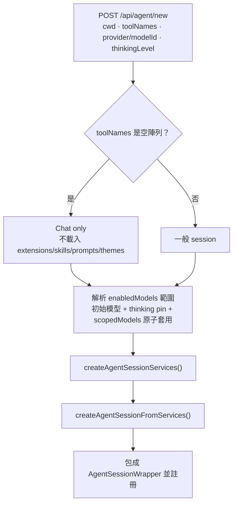

# 04 · Agent、工具與 Subagent

本篇說明一個 `AgentSession` 是怎麼被組出來的：工具選擇、內建 extension、
subagent、以及為了讓 pi CLI 的 extension 能原樣運作而做的相容層。

---

## 1. 建立 session 時決定了什麼

`startRpcSession()` 建立 `AgentSession` 時，依序決定：



**這些都是 session 範圍的**：瀏覽器選的模型與 reasoning 不會寫進 `settings.json`
（pi 的 `/model`、`/thinking` 也只在 Ctrl+S 才持久化）。使用者按星號存預設值時才走
`PUT /api/models/default`。

---

## 2. 工具選擇（preset）與 Chat only

工具名稱在建立 session 時以 `toolNames[]` 傳入，並以**版本化的 custom entry**
`pi-web:tool-selection` 持久化在 session 檔裡（ADR 0002）：

```json
{ "type": "custom", "customType": "pi-web:tool-selection",
  "data": { "version": 1, "tools": [] } }
```

- 沒有 entry，或較晚有一個 `{ "version": 1, "cleared": true }`，
  表示**沒有 pin**：session 跟隨 pi 的 `defaultTools`
  （也就是 preset 選單裡的「From settings.json defaultTools」，它送出時不帶 `toolNames`）。
- `tools: []` 表示 **Chat only**。它必須在 `createAgentSessionServices()` **之前**解析完，
  因為 Chat only 不能 import 或執行任何 session extension。
- **跨越 Chat only 邊界或清掉 pin 會重建 wrapper**；在非空 preset 之間切換只是就地更新。
- 沒有 pin 的既有 session 顯示 `configured`；有 pin 的顯示自己的選擇
  （`GET /api/sessions/[id]` 的 `toolNames`，之後再以 live `get_tools` 校正）。

### Chat only 的三個後果

1. **不載入** extensions、skills、prompt templates、themes，也沒有 pi 的基礎系統提示。
2. **精確系統提示**改成 pi 預設 loader 發現的 context 檔案的**有序內容**
   （全域與專案的 `AGENTS.md`、`AGENTS.override.md`、`CLAUDE.md`）。
3. **模型選單仍然會載入 extension**（為了列出 extension 提供的模型），但 session 不會。
   所以一個只有 extension 才提供的模型會被標示為「extension 提供，但此 Chat-only
   session 沒有」：瀏覽器選了它，啟動會被拒；`set_model` 也會拒（而不是回
   「Model not found」）。

### `set_tools`（工具列）

`POST /api/agent/[id] { type: "set_tools", toolNames }` → `setRpcSessionTools()`。
它會等待正在關閉的 wrapper 或正在進行的啟動，再把選擇套用到結果 wrapper 上
（**絕不**透過第二個 `SessionManager`）。

---

## 3. 工具曝露（exposure）

pi 對工具的可見性有四種：

| exposure | 意義 |
| --- | --- |
| `direct` | 模型可以直接呼叫，宣告會進請求 |
| `model-only` | 模型可見、可呼叫，但 codemode 腳本呼叫不到 |
| `codemode` | 預設不啟用；由 codemode 腳本呼叫 |
| `deferred` | 由 `tool_search` 找到後才啟用 |
| `hidden` | 已撤回，`setActiveToolsByName()` 忽略，`get_tools` 也不列 |

註冊時 pi 會啟用 `direct` 與 `model-only` 的工具，除非定義帶
`defaultActive: false`（`codemode` 與 `tool_search` 就是）。

**重要細節**：

- `prepareLoadout` hook 會在**每次 loadout 變更**時改寫工具清單（包含工具註冊時）：
  codemode 的定義只留 intro，而實際宣告的那份會列出腳本可呼叫的工具、
  MCP 命名空間與型別，並把 codemode 宣告附加到可呼叫的 `direct` 工具之後。
- **preset 只替換 coding tools**。`resolveActiveToolNames()` 會保留其他
  「active、已註冊、非 hidden」的工具，所以 extension、`tool_search` 或
  `defaultTools` 裡 `+codemode` 這類條目啟用的工具能活過 startup / `set_tools` /
  `reload`；被 extension 關掉的工具也保持關閉；preset **永遠不會**自己打開 codemode。
- `navigateTree()` 會從目標分支的 transcript 還原它的 loadout（例如 Read-only pin
  底下 `write` 會回來、`codemode` 會消失），之後一般 session 再套用自己的 pin
  （未 pin 則用還原的那份），並把 session 自己的工具（`codemode`、`tool_search`、
  Pi Web 的 subagent 工具）帶過去。其他 extension 工具則跟隨目標分支的 loadout，
  與 pi CLI 一致。

---

## 4. 內建 extension（`lib/builtin-extensions.ts`，ADR 0006）

pi CLI 有三個內建 extension：`codemode`、`tool-search`、`mcp`。
pi-web 從 SDK 匯出的 factory **重建**它們，用 CLI 的名字、並標上
`replaceable: true, builtin: true`，所以：

- `-builtin:<name>`、專案覆寫、被第三方 extension 取代、`noExtensions`
  的行為都跟 CLI 一樣；
- 一個**無法執行**的內建（例如 codemode sandbox 自我測試失敗）會保留
  `builtin:<name>` 條目但用空的 factory，所以指名它的設定語意相同。

一般 session 三個都載入。**MCP 在以下情況會整個關閉（`mcp` 條目什麼都不註冊）**：
`PI_WEB_DISABLE_MCP` 是非空、非 `0`、非 `false`，或 `lib/pi-sdk-internals.ts`
載入失敗。**絕不**退回 SDK 自己的 transport。

### 4.1 Codemode

- 只有在**每行程一次**的自我測試（`checkCodemodeSandbox()`，實際讓 SDK 沙箱跑一段
  腳本）通過之後才提供。
- 腳本用 `ctx.executeTool()` 呼叫工具，事件帶 `parentToolCallId` 與
  `<parent>/<n>` 形式的 id。這些巢狀事件在送出前會被精簡：start/end 送、
  update 丟棄，且判斷嵌套要在重建 update **之前**做。父層的 end 會忘掉
  `<parent>/` 底下所有 id；`agent_end` 清空整個重播集合。
- codemode 卡片（`components/CodemodeToolView.tsx`）把腳本顯示在一般工具輸入的框裡，
  並把 `details.calls` 顯示成列，不是卡片——那些呼叫沒有以 tool call 的形式到模型。
  更新時 `details.calls` 只保留最新 200 筆，其餘以 `omittedCalls` 計數。

### 4.2 Tool search

`tool_search` 用自然語言找 `deferred` 工具。它與 codemode 一起讓
「宣告很短、工具很多」這件事成為可能：MCP 伺服器的工具預設 `codemode` 曝露
（由 codemode 腳本呼叫），沒有可用沙箱時則註冊為 `deferred`（靠 `tool_search` 找到）。

### 4.3 MCP

內建 MCP extension 的 `loadConfig` **回傳空的伺服器清單**（只回
`autoEnableCodemode`），並設 `startupWaitMs: 0`。實際的伺服器由
`lib/mcp-host.ts` 透過 `pi.registerMcpServer()` 註冊。詳見
[05-config-and-mcp.md](05-config-and-mcp.md#3-mcp-執行期libmcp-hostts)。

---

## 5. Read-only MCP 政策（`lib/mcp-read-only-policy.ts`）

當 session 的 pin 是**唯讀**（有指名工具，且其中沒有 `bash` / `powershell` /
`edit` / `write`；沒有 pin **不算**唯讀）時，一個 `tool_call` handler 會擋掉**每一個**
定義中沒有 `annotations.readOnlyHint: true` 的 MCP 工具，codemode 腳本裡的呼叫也算。

- pin 是從 session 檔的 entries 讀的，而 `set_tools` 會先寫入再套用，所以執行中無法改變。
- 這個 hint 是**伺服器自己的說法**：這個政策防的是模型誤用，不是惡意伺服器。
- subagent 有自己的一份（`createSubagentMcpPolicyExtension()`），讀 profile 的工具設定
  而不是 pin；當子 session 的內建工具是唯讀的（例如 Explore、Plan）時，
  它也擋掉沒有 `readOnlyHint` 的 MCP 工具——包含 codemode 腳本。

---

## 6. 精確系統提示（`lib/exact-system-prompt.ts`）

精確系統提示走 **`before_agent_start`** handler，回傳 `{ systemPrompt }`：
SDK 會把它當成 provider 的前導系統提示送給模型，而 transcript 仍保留 pi 的結構化段落。

- Chat-only session 註冊 `lib/exact-system-prompt.ts` 這個 inline extension factory。
- subagent（profile 是 replace 模式，或指名了 `skills:`）則由 `lib/subagent-skills.ts`
  的對等 handler 處理。
- 直接指定 `agent.state.systemPrompt` 會拋錯（它是從 transcript 的 system 訊息重播的
  getter），而 patch `prepareNextTurnWithContext` 從來不會到模型。
- `get_state.systemPrompt` 對這些 wrapper 回報的就是精確提示。

---

## 7. `defaultTools` 開關（`/api/tools/settings`）

`/api/tools/settings` 是**唯一**寫入下列鍵的地方，且都經
`lib/global-settings-file.ts`（取 pi `SettingsManager` 在該檔上的鎖）：

| 設定 | 寫法 |
| --- | --- |
| Code mode「Always on」 | 在 `defaultTools` 加 `+codemode` |
| Code mode「Automatic」 | 不寫任何東西（ADR 0006） |
| PowerShell | 同名開關（Windows） |
| `codemode.mode` | `"on"`（pi 預設，移除該鍵）或 `"only"` |
| `codemode.inlineBudget` | 0–1 000 000 的整數，或 `null` 移除該鍵 |

- `defaultTools` 可以有 `+name` / `-name` 修飾詞；讀取要透過
  `SettingsManager.getDefaultTools()` 解析后的結果，編輯前要用同一條規則解析原始清單
  （把單純的名字 append 到「只有修飾詞」的清單會弄丟 pi 的預設工具集）。
- `codemode.inlineBudget` 是 codemode 描述宣告工具時能花費的估計 token 數
  （由短到長排序），預設 3000。
- 專案 `.pi/settings.json` 的 `defaultTools` 會取代全域值；面板會標明是哪個檔案決定
  （`projectCodemodePreference()` 不自己重實作 pi 的合併規則，而是把專案的原始文字
  餵給 SDK 的 `SettingsManager` 再比較）。

---

## 8. Subagent

Subagent 是 Pi Web 自己實作的一組工具，提供「把一個有界的工作交給子 session」。

### 8.1 開關與 profile

- 全域開關在 `~/.pi/agent/agents/settings.json` 的 `builtInEnabled`：
  **檔案或欄位不存在、或檔案壞掉時視為 off（fail closed）**。寫入是原子性的，並保留未知欄位。
- `maxConcurrent` 限制同時執行的子 session 數。
- Profile 檔在 `~/.pi/agent/agents/*.md` 與 `<project>/.pi/agents/*.md`，
  frontmatter 與其他 runtime 共用。儲存時會**往返保留** `MANAGED_FRONTMATTER_KEYS`
  以外的每個鍵（例如 `name`、`allowed_subagents`、`exclude_extensions`、
  `disallowed_tools`），並帶著外來的 `ext:` 工具選擇器。
- 三個內建 profile（`general-purpose`、`explore`、`plan`）是以 `disabledBuiltIns`
  **依名字關閉**，不是複製成 `.md`（ADR 0005）。同名檔案會整個取代內建，並以自己
  frontmatter 的開關控制。

### 8.2 三支工具與保留名稱

`Agent`、`get_subagent_result`、`steer_subagent`（`SUBAGENT_CONTROL_TOOL_NAMES`）。
它們以 `exposure: "model-only"` 註冊，所以 **codemode 腳本無法啟動、收集或操縱
subagent**：腳本啟動的 run 會把巢狀呼叫 id（`<codemode call>/<n>`）記成
`parentToolCallId`，而沒有任何 transcript entry 帶著它，對話就失去與子 session 的連結。

### 8.3 `Agent` 允許模型決定的參數

`subagent_type`、`prompt`、`description`、`run_in_background`、`resume`、
`input_files`、`model`、`isolation`。

**Thinking level、回合上限、是否繼承父層上下文都屬於 profile**
（frontmatter 的 `thinking`、`max_turns`、`inherit_context`），不是呼叫參數。
pi 的驗證器允許 schema 沒列出的鍵，所以仍帶著它們的呼叫會被接受但忽略該鍵。

`model` 的解析是 `request ?? profile`，格式與 pi 的 `--model` 相同：
`provider/modelId` 或裸 id，可選地在結尾加 `:<thinking level>`。
`model: "x:high"` 同時設定該 run 的模型與思考等級；只寫模型不寫等級則沿用 profile 的
`thinking`。profile 內的 `thinking:` 優先於它自己 `model:` 上的等級（如同
`--thinking` 優先於 `--model x:level`），pi 會把等級夾到模型支援的範圍。

`resume` 保留子 session 的 profile、模型、思考等級與上下文，但續接的 prompt、
description、背景模式可以改變；**非空的建立選項（`model`、`input_files`、`isolation`）
會被拒絕**，要改就開一個新的 subagent。

### 8.4 資源政策（`resourceSnapshot`）

每個子 session 的 `resourceSnapshot` 記下工具與 profile 的技能/extension 開關，
讓 reload、resume、RPC reopen 都能還原同樣的資源政策；無法還原的 snapshot
會被拒絕而不是當成一般 session 重開。

- **`codemode: inherit | on | off`**（缺省 `off`）。`inherit` 跟隨**父 session 在 spawn
  當下** codemode 是否 active，不是父層的 `codemode.mode` 或 `inlineBudget`
  （子 session 從自己的設定讀）。子 session 只載入 codemode factory，
  永遠不載一般 session 的 MCP host 或 tool-search。
- **`mcp: on | off`**（缺省 `off`，沒有 `inherit`）。開啟時子 session 用**自己的**
  `McpHost` 載入 `builtin:tool-search` 與 `builtin:mcp`，連自己的伺服器
  （stdio 伺服器會再啟一份）。每個子 session 的 host 在它關閉時 dispose，
  閒置釋放同樣適用。
- **`skills:`** 清單會把那些 skill 的內文（去 frontmatter）預載進子 session 的提示，
  兩種 prompt 模式都適用，並隱藏技能目錄。名稱是在 SDK 已發現的 skills 裡查表，
  絕不當路徑用。
- **`extensions:`** 清單是 `extensionsOverride`：SDK 載入後把其餘 extension 丟掉
  （連同它們 factory 排入的 providers 與 models）。被丟掉的 extension 不會綁任何
  handler、工具或命令，但**它的 factory 已經跑過一次**——這是 scope，不是沙箱。
- 若子 session 載入 extension 卻**沒有** `ext:` 選擇器，則不給 `tools` allowlist
  （SDK 在建立 session 時就固定一份，晚註冊的工具會永遠叫不到）。此時改用
  `noTools: "builtin"` 加上 profile 的內建工具 `+name`，並排除保留工具與其他 SDK 內建。

### 8.5 執行、回合上限與通知

- 一個 run 從 dispatch 到結果 entry 被寫入前都留在 `getSubagentRuns()` 裡；
  所以「有持久化的 running 狀態、沒有結果、也沒有 wrapper」會被判為 `interrupted`
  （它的行程已經停了，不會有人完成它）。
- `max_turns` 允許**一次**收尾回合，且只在 SDK 原本會繼續時。收尾回合會把
  `steeringMode` 設成 `all`，讓先前排隊的 steer 不能把指令壓住。`end` 決定本身
  不會停止 run：limiter 會清空佇列、把那些訊息列在回合上限錯誤裡，並從此拒絕
  `steer_subagent`。
- `notifyParent` 會跳過「父層已用 `get_subagent_result` 收走結果」的背景完成通知
  （該次收集會標記為 consumed，標記以 `sessionId` + `completedAt` 命名，因為
  `resume` 會重用 session id）。父層正在跑時通知會先擱著，等它 idle 再發。
- 通知是一則 `custom` 訊息，pi 的 `convertToLlm` 會把它當成普通的 user 回合重播，
  所以 `subagentNotificationText()` 會加上 `SUBAGENT_NOTIFICATION_PREFIX`；
  否則壓縮時會把報告歸類到使用者的 Goal / Constraints 底下。**這個前綴必須留在程式碼裡，
  不可以放到 profile 的提示中**，不然模型可以丟掉它。

### 8.6 Viewer 分頁

`Agent` 卡片的按鈕會把子 session 開成右側面板的唯讀分頁（tab id `agent:<sessionId>`）。
它只讀 `/api/sessions/[id]` 與 `/context`（執行中 wrapper 的記憶體 entries，否則讀檔），
**不碰任何 `/api/agent/` 路由**，所以「看」不會啟動、重開或續命一個 AgentSession。

---

## 9. Extension 相容層

原則：**為 pi CLI 寫的 extension 在 Pi Web 要有一樣的行為**。顯示層的問題在網頁修。

### 9.1 `ctx.ui.*` 與 extension UI 請求

`ExtensionUiRequest` 的方法（`lib/types.ts`）：

| method | 阻塞？ | UI |
| --- | --- | --- |
| `select` / `confirm` / `input` / `editor` | ✅ | 對話框 |
| `custom` | ✅（直到 `closed: true`） | 自訂面板（`lines[]`） |
| `notify` | — | 通知 |
| `setStatus` | — | 狀態列 |
| `setWidget` | — | widget（`aboveEditor` / `belowEditor`） |
| `setTitle` | — | 標題 |
| `set_editor_text` | — | 填入輸入框 |

- **阻塞式請求**（`isBlockingExtensionUiRequest()`）會讓側邊欄把該 session 顯示成
  「等待輸入」（琥珀呼吸點），而不是執行中的 spinner；它同時也是瀏覽器通知的來源。
- 佇列邏輯在 `lib/extension-ui-queue.ts`：`enqueueExtensionUiRequest`、
  `upsertExtensionUiRequest`（同 id 取代）、`retainExtensionUiRequests`（重連時
  以伺服器重播的 id 清掉已關閉的）、`removeExtensionUiRequest`。
- SSE 的 `connected` 事件帶 `pendingExtensionUiIds`，讓重連的客戶端丟掉那些
  在它離開期間被關掉的請求。
- `extension_ui_response` / `extension_ui_input` 命令把答案送回 wrapper。

pi TUI 的 custom UI 由 `lib/custom-ui-terminal.ts` 的 headless 終端機模擬，
讓需要 TUI 渲染器的 extension 仍能得到合理的 `lines[]`。

### 9.2 狀態列與命令按鈕（`components/ExtensionStatusBar.tsx`、`ExtensionWidgets.tsx`）

- `ctx.ui.setStatus(key, text)` 進到 wrapper 的 `extensionStatuses` map，以
  `extension_ui_request`（`setStatus`）到頁面，重新載入後由 `GET /api/agent/[id]`
  的 state 還原。
- **key 若形如 `command:/name args`，該格就變成按鈕**，按下會以 `handleSend` 送出該
  斜線命令（session 忙碌時停用）。命令放在 key 裡是因為 `setStatus` 沒有多餘的欄位，
  而且 pi 自己的 footer 只印文字，所以同一則狀態在 CLI 是純文字。
  **只有 `/…` 開頭的命令合格**：其他字串會送到模型，`!` 會跑 shell 命令。
- 狀態只有在 wrapper 活著時存在，所以全新的對話或還沒被 prompt 過的 session
  不會有任何格子和按鈕。

### 9.3 關機期限

extension 的 `session_shutdown` 有 `PI_WEB_SHUTDOWN_DEADLINE_MS`（預設 5 秒）可用，
之後 wrapper 記一次 log 就強制 dispose——關掉一個 MCP 連線沒有上限。

### 9.4 保留名稱與衝突

內建 subagent 開啟時，**只有**一個「已辨識的舊版 `pi-subagents` extension」
註冊了保留工具（`Agent`、`get_subagent_result`、`steer_subagent`）才會被移除，
連同它造成的衝突錯誤；無關的 extension 不動。

---

## 10. 與 pi CLI 的行為對照速查

| 主題 | pi CLI | Pi Web |
| --- | --- | --- |
| 工具選擇 | `--tools` / `defaultTools` | preset → `toolNames` + `pi-web:tool-selection` entry |
| Chat only | — | 空 `toolNames`，不載入任何資源 |
| 模型 / 思考持久化 | 只有 Ctrl+S | 只有星號（`PUT /api/models/default`） |
| `/reload` | 串流或壓縮中拒絕 | 相同，且執行中的 wrapper 也拒絕 |
| `/mcp` | 內建命令 | 裸 `/mcp` 開 Settings › MCP；子命令照送 |
| 內建 extension | `dist/extensions/index.js` | 從 SDK factory 重建，同名同 `-builtin:` 語意 |
| subagent | `pi-subagents` extension | Pi Web 自己實作（ADR 0003/0005） |
