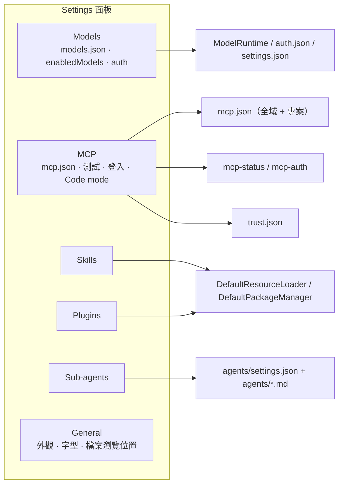
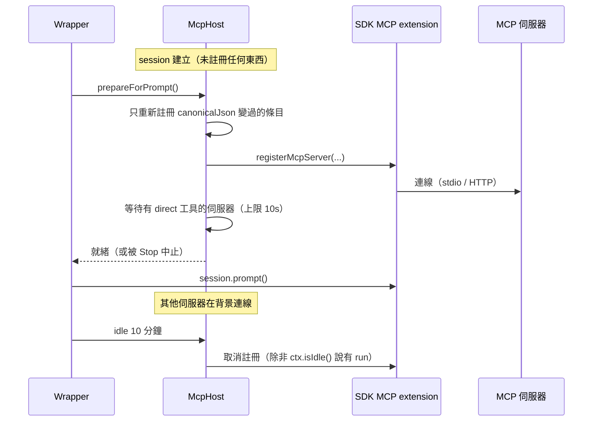

# 05 · 設定：模型、MCP、Skills、Plugins 與信任

Pi Web 的設定面分成兩類：

1. **直接讀寫 pi 的檔案**（`settings.json`、`models.json`、`auth.json`、`mcp.json`、
   `trust.json`、`agents/*.md`），所以兩個介面看到同一份設定；
2. **Pi Web 自己的狀態**（`pi-web-session-state.json`，以及瀏覽器端的偏好）。



---

## 1. 模型與供應商認證

### 1.1 新 session 的預設

- `GET /api/models` 回 `defaultModel`（來自 `~/.pi/agent/settings.json`），
  `ChatWindow` 用它預選新 session 的模型。
- 瀏覽器的選擇是 **session 範圍**：啟動與執行中的 `set_model` / `set_thinking_level`
  都不寫 `settings.json`（pi 的 `/model`、`/thinking` 也只在 Ctrl+S 才持久化）。
- 存預設是模型選單每列的星號（等同 pi 的 Ctrl+S），走 `PUT /api/models/default`
  （`lib/default-preferences.ts`）。它只接受在解析後 `enabledModels` 範圍內的模型，
  確保存下的預設一定生效；若專案 `.pi/settings.json` 設了同名鍵，
  回 `409 { reason: "project-scope", settingsPath }`，因為那個值會贏。
- **Reasoning 控制項在串流中仍可用**：pi-agent-core 在 run 開始時快照 `reasoning`，
  但 `AgentSession` 的 `prepareRequest` / `prepareNextTurnWithContext` 會在**每次**
  模型請求前重讀 `agent.state.thinkingLevel`，所以設定從下一個請求生效
  （已在串流的那個回應保持原等級）。

### 1.2 `enabledModels` 範圍

`enabledModels` 用 pi 的 `--models` 語法：對 `provider/modelId` 或裸 `modelId` 的
minimatch glob、非 glob 模式的模糊比對，可選 `:thinkingLevel` 後綴。

- **絕不把 pattern 當字串比較**：`lib/model-scope.ts` 委派給 SDK 的
  `resolveModelScopeWithDiagnostics()`，讓 pi-web 與 TUI 一致；pattern 解析不出任何東西時
  退回「所有可用模型」。
- `startRpcSession()` 在建立 AgentSession 前解析範圍，把初始模型、thinking pin 與
  SDK 原生 `scopedModels` **原子地**傳入。
- 選單順序照 pi 的 `/model`（`orderSelectorModels()`）：有 scope 就依
  `enabledModels` 的順序，否則只依 provider id 排序（所以 models.json 的 provider
  保持檔案裡的順序——issue #783）。`ModelSelector` 依 provider 首次出現順序分組，不再重排。

### 1.3 最小編輯引擎（ADR 0004）

`/api/models/enabled` 的每個切換都是**最小編輯**（`lib/enabled-models.ts`）：

- 未匹配的 pattern **原樣保留**；只就地把「覆蓋被關掉模型的那個 pattern」展開
  （保留它的 `:level`）。
- 一個完全啟用、且有兩個以上條目的 provider 會收合成單一 glob
  （列舉清單會在下游 catalog 改名時腐爛）；只有單一精確引用會保留。
- **絕不**照 TUI 的 `/scoped-models` 用 `getAvailable()` 重寫整份清單：那只看得到
  當下通過 `checkAuth()` 的 provider，會丟掉已登出 provider 的條目、抹平 glob 與 pin。
- **絕不假設 `provider/*` 涵蓋一個 provider**：minimatch 的 `*` 在 `/` 停下，
  漏掉嵌套 id（例如 `commandcode/sakana/fugu-ultra`、多數 OpenRouter id）。
  `resolveProviderGlobs()` 只有在 glob 剛好匹配該 provider 的所有模型時才保留
  `provider/*` 或 `provider/**`，否則逐模型寫。
- 關掉最後一個已啟用模型會被拒（`409 { reason: "last-model" }`）：空的 scope 等於所有模型。
- 寫入只進全域設定檔。專案 `.pi/settings.json` 的 `enabledModels` 會取代全域陣列，
  此時路由回報 `scope: "project"` 且開關唯讀。
- `op: "prune"` 是唯一會丟掉未匹配條目的操作（catalog 改名後的清理）；
  `op: "clear"` 移除該設定；其他操作都保留它們。
- 儲存 `models.json` 時會呼叫 `op: "resync"`（唯一會修復條目的操作）：重寫改名的模型、
  再重寫改名的 provider、縮回不再被 provider 前綴涵蓋的條目、並重新斷言「存檔前完全啟用」
  的 provider。沒有這一步，一次改名就會弄壞 scope。

### 1.4 遠端 catalog 與延後註冊的 provider

- 內建模型清單在 SDK 版本就凍結了；新模型來自 SDK 的 pi.dev catalog overlay，
  `ModelRuntime.refresh()` 會把它持久化到 `~/.pi/agent/models-store.json`
  （pi CLI 也會填），而且**離線時會還原**。pi-web 自己的 runtime 只還原它
  （`allowNetwork: false` / `refreshOnCreate: false`）。
- **網路抓取只在使用者按下「Refresh catalog」時發生**（`POST /api/models/refresh`），
  永遠不排程、也不順手觸發。它用 `force: true` 且不帶 `allowNetwork`，所以
  pi 的 `PI_OFFLINE` 規則成立；同時按下會被 `shareModelCatalogRefresh()` 合併。
- **在 `session_start` 才註冊 provider 的 extension**：每個模型列表都建立新的
  `ModelRuntime`，而有些 extension（例如 pi-claude-bridge）只在一個行程的第一個
  runtime 註冊 provider，之後延到 `session_start`。`lib/deferred-provider-models.ts`
  記住每個 runtime 看過的可用模型，並把「runtime **完全沒有**註冊的 provider」的模型加回來
  （有註冊但不可用（已登出）的絕不加）。`startRpcSession()` 若被要求一個延後模型，
  會先用預設模型建立，等 `session_start` 跑完再 `set_model`。

### 1.5 認證

- `ModelsConfig` 結合 `~/.pi/agent/models.json` 與 pi `ModelRuntime` 的 provider
  認證狀態（`/api/auth/providers`，透過 `createModelRuntimeWithExtensions()`）。
- **provider 列表是能力驅動，不是 id 驅動**：`lib/provider-listing.ts` 依
  `auth.apiKey.login` / `auth.oauth` 加上已存憑證的型別決定成員，所以雙認證 provider
  （anthropic、github-copilot…，這組在 SDK 版本間會變）只出現一次。
- `auth.json` 每個 provider **只有一份**憑證，而 `ModelRuntime.logout()` 會刪掉當下那份，
  所以刪除路由用 `removeStoredCredentialIfType()`（在 pi 的 auth 檔鎖底下比對後刪除）。
  任何認證變更後 `ModelsConfig` 都會重新整理**兩份** provider 列表，否則雙認證 provider
  會渲染兩次。
- OAuth / device-code / 手動碼流程從 `GET /api/auth/login/[provider]` 串流；
  手動碼以短命 token 存在 `globalThis.__piLoginCallbacks` 後 POST 回去。
- API key 路由透過 `lib/provider-credential-store.ts` 存取，**不**走 `AuthStorage`，
  也**不**走 `ModelRuntime.login()`（那會跑沒有上限的 catalog refresh）。
  狀態端點永不回傳原始 key。
- `lib/model-discovery.ts`（Fetch models）只複製「意義不隨 gateway 改變」的能力欄位：
  `contextWindow`、`maxTokens`、`reasoning: true`，以及從 advertised effort 清單映射來的
  `thinkingLevelMap`（對應 pi 自己的等級，其他 `null`，`off` 不動）。
  語意模糊的欄位（`max_tokens`、`default_effort`）與垃圾值一律丟棄。

---

## 2. MCP 設定檔的讀寫（不執行任何東西）

`GET /api/mcp` 的一切都**只讀檔**：它從不 spawn 伺服器、不開連線、不解析任何值，
所以列出一個不受信任的專案和列出全域檔案一樣安全。這條路徑上不可以呼叫
`createDefaultTransport()`、`resolveConfigValueOrThrow()`、`connection.oauthSettings()`
（每個都會執行 `!command`）或 `McpOAuthCredentialStore`（光是讀就會建立
`mcp-auth.json` 與鎖）。

### 2.1 遮罩：沒有任何字面值進瀏覽器

- 環境變數與標頭的**值**永不送出（只送名字）。
- `command`、`args`、`url` 經 `lib/mcp-secrets.ts` 遮罩：URL 的 userinfo、
  名字像憑證的查詢參數或看起來像 token 的值、裸 token 樣的查詢片段與路徑片段、
  `--api-key=…` / `--token X` / `-k X` / `--auth X`、`Name: value` 標頭、
  `NAME=value` 配對、`Key=value;…` 連線字串。多字的值（`command` 裡整條命令列、
  當成單一參數的 `Bearer …`）逐字遮罩，`Bearer` / `Basic` / `Token` 或憑證樣的
  `Name:` 會讓下一個字成為秘密。
- SDK 不會展開這三個欄位，所以**只有佔位符形狀的值**會留在畫面上：`${NAME}`、
  或全大寫的 `$NAME`（`mcp-remote`、`sh -c` 這類 wrapper 會展開它）。
  `$Passw0rd` 會被遮罩。
- SDK 真的會解析的欄位（env、headers、`oauth.clientSecret`）用 SDK 自己的語法
  `isReferenceOnly()` 判斷（任意大小寫的 `$name`、`$$` / `$!` 轉義）。
- **例外**：一個「沒有任何決策信任」的專案，它的 `command` 與 `args` **照原樣**顯示
  （URL 仍遮罩，但主機名不遮）——ADR 0006。理由：用形狀遮罩等於讓連結的作者決定
  使用者在自動測試執行它之前**看不到什麼**。
- JSON 語法錯誤**永不引用檔案內容**（`jsonErrorMessage()`）：V8 會引用未預期 token
  附近的文字，那常常是一個字面秘密。
- `maskStatusError()` / `maskStatusStderr()`：先遮罩再截短，所以任何截斷都不會留下
  半個秘密。

### 2.2 每個檔案各自讀

每個檔案**各自**讀，不透過 `loadMcpConfig()`（那會跳過不受信任專案檔並依名字合併，
把被專案條目取代的全域條目藏起來）。

- 解析方式與 SDK 相同（`JSON.parse`、不剝 BOM、`{ mcpServers: {} }`、
  `autoEnableCodemode` 是布林）。內建載入成功時，每個條目用 SDK 的
  `validateMcpServerConfig()` 檢查，不合格的仍列出但附原因。
- 除驗證器之外，`refuseAsLoaderDoes()` 會拒絕 `loadMcpConfig()` 會跳過的：
  命名空間已被較早載入的條目佔用（`a-b` 與 `a_b` 共享命名空間，後者被拒）、
  以及專案檔裡同時有 `url` 與 `auth` 的條目（**儲存庫不該決定 provider 的 token 送去哪**）。
- 全域條目只有在專案條目「真的會載入」時才標 `shadowedByProject`。
- **專案檔案受檔案存取連結規則保護**：它的真實路徑（含檔案內或 `.pi/` 內的連結）
  必須在路由檢查過的允許根目錄內；懸空的連結被拒（`link-dangling`），
  不會被當成「沒有檔案」。以 `O_NOFOLLOW | O_NONBLOCK` 開啟一次並用 `fstat` 檢查
  （一般檔、上限 1 MiB），所以 FIFO 永遠不會被讀。超過 200 個伺服器
  （`MCP_PROJECT_MAX_SERVERS`）是 `too-many-servers`，什麼都不列。
- **全域檔案是使用者的**：連結跟到哪裡都算，懸空的讀成沒有檔案（與 SDK 一致）。

### 2.3 專案覆寫（pi 1.0.1）

一個沒有 `command`、`url`、`type` 的專案條目，只會改變同名全域伺服器的
`enabled`、`exposure`、`toolExposure`。讀取端遵循 `loadMcpConfig()`：需要有一個
「會載入」的全域條目，且專案條目除了那三個鍵以外什麼都沒有，否則以 loader 的說法
列為被拒（`mcpOverrideRefusal()`）。合併後的條目會再驗證一次，那一份就是該列描述的內容
（`override: { keys }`），且**不論專案是否受信任**都像全域條目一樣遮罩。

Test、sign-in、sign-out 都從列表取設定（`readMcpServerConfig()`），**不從原始條目**，
所以一個覆寫連線時身分等同它改的那個全域伺服器。

### 2.4 寫入（`lib/mcp-config-file.ts`、`POST /api/mcp`）

**每一次 `mcp.json` 寫入都走這個模組**，不用 SDK 的
`add/update/removeMcpServerConfig()`（ADR 0006）。它的輸出必須與 SDK 編輯器
**逐位元組相同**（第一行縮排、結尾必有 `\n`、`enabled: true` 與
`exposure: "codemode"` 會刪掉該鍵——但在專案覆寫裡要保留，因為它們是拿來取代全域值的；
未知鍵保留），差別只是一個什麼都沒改的編輯不會動檔案。
`lib/mcp-config-file.test.mjs` 會在每個 fixture 與操作上與 SDK 編輯器的位元組比較。

- **先鎖再原子替換**：同一真實路徑的寫入先在 globalThis 排隊
  （`Symbol.for("pi-web:mcp-config-write-queue")`），再對 `<real path>.lock` 取
  proper-lockfile 鎖（約 3 秒重試，之後回 `locked`）以對抗其他 Pi Web 行程；
  **pi CLI 寫入時不取鎖**。文字寫到**真實檔**旁邊的暫存檔（`wx`、0600，再 `chmod`
  成最終模式），再 rename 蓋過去，所以讀者（prompt 前同步的 host）只會看到舊檔或新檔，
  而且符號連結仍是連結（寫設定路徑會把 dotfiles 連結換成一般檔）。
- **模式**：全域檔永遠 0600（可能含字面秘密），為它建立的資料夾 0700；
  專案檔保留自己的模式（用 `chmod` 而非 umask），新檔 0644。
- **寫到哪裡**：全域跟隨連結、懸空的就照它指的名字建檔。專案遵循讀取端的連結規則，
  真實路徑必須在允許根目錄內，懸空連結（檔案或 `.pi/`）被**拒絕**而不是當成缺檔。
- **拒絕**是 `McpConfigWriteError`（用 `Symbol.for` 品牌，所以第二份模組副本也認得），
  `reason` 由路由回成 409：`unparsable`、`invalid-shape`、`server-missing`、
  `name-taken`、`link-dangling`、`link-outside`、`not-a-file`、`too-large`、`locked`；
  `unreadable` 是 500 `internal`。

### 2.5 `POST /api/mcp` 的動作

| action | 內容 |
| --- | --- |
| `enable` / `disable` / `remove` | `{ scope, name }` |
| `set-enabled` | `{ enabled, servers: [{ scope, name }] }` —— 每個檔案一次寫入，每個伺服器一個 `results` 條目，所以被拒的不會拖住其餘 |
| `set-exposure` | `{ scope, name, exposure }` |
| `set-in-project` | `{ name, enabled }` —— 只在 `cwd` 的專案裡開/關一個全域伺服器（等同 `/mcp` 的「Enable / Disable in this project」）；沒有專案條目時附加一個覆寫，已有覆寫則修補它 |
| `undo` | `{ token }` |
| `sign-out` | 見 §5.3 |
| `add` | 見 §6 |

**檢查順序**：來源（403 `request-denied`）→ JSON content type（415）→ JSON 物件
（400）→ cwd（`cwd-invalid` / `cwd-denied` / `cwd-not-directory`）→
**MCP 停用時伺服器清單唯讀**（409 `mcp-off`：`PI_WEB_DISABLE_MCP` 或 SDK 模組載不進來；
**不是** `-builtin:mcp`，也**不影響** Code mode 選擇）。

專案伺服器另外需要 cwd，以及一個「確切或繼承自祖先」的信任決策（403 `project-untrusted`；
`trust.json` 不可讀則 409 `trust-unreadable`）——用的是 `mayReadProjectConfigNow()`
的規則，**不是** `trust.trusted`（那對「不需要信任的資料夾」也是 true）。
把一個引用 `PI_WEB_PASSWORD` 的條目打開是 409 `web-password`（在鎖底下對當下的條目檢查）；
關掉與移除則可以。

### 2.6 Undo

`lib/mcp-undo.ts`：移除時把原始條目與它的索引存在
`globalThis[Symbol.for("pi-web:mcp-undo")]`（上限 100），以 `randomUUID()` token 為 key、
保留 60 秒。回應帶 `{ token, scope, name, path, expiresInMs }`（剩餘時間，所以瀏覽器
時鐘不重要），**永不帶條目本身**（可能含字面秘密）。`undo` 只取用一次記錄
（再來一次是 410 `undo-unavailable`），重跑任何寫入的檢查，把條目放回**它原本的位置**，
其他都沒變時逐位元組還原。一個重新被定義的名字永不被取代（409 `undo-name-taken`）。
伺服器重啟會丟掉待處理的 undo。

---

## 3. MCP 執行期（`lib/mcp-host.ts`）

`createPiWebBuiltinExtensions()` 回 `{ extensions, mcpHost }`，`startRpcSession()`
把 host 交給 wrapper。host 的 inline extension 讀全域與專案的 `mcp.json`，
透過 `pi.registerMcpServer()` 註冊伺服器；SDK 內建 extension 的 `loadConfig` 保持空的（ADR 0006）。



- **在 prompt 之前什麼都不連**（ADR 0006）。在沒有 run 進行時送出的 prompt，
  wrapper 會呼叫 `prepareForPrompt()`：只重新註冊 canonical JSON 變過的條目，
  然後最多等 10 秒讓「有 `direct` 工具」的伺服器連上；一個撐過整段等待的伺服器
  不會再被等待第二次。其他伺服器像 pi 1.0 一樣在背景連線。
- `before_agent_start` 也會同步（不等待），涵蓋繞過 wrapper 的 prompt。
- **Stop 會中止那段等待**：prompt 以 `MCP_WAIT_STOPPED_MESSAGE` 被拒後未送出，
  客戶端還原草稿。**絕不**把等待搬進 `before_agent_start`：pi 在 run 有 abort signal
  之前就發出它，而 `AgentSession.abort()` 在 run 開始前什麼都不做。
- **連線狀態來自 transport**，不是 extension 回報。`wrapTransportFactory()`
  包住 pi-web 的 factory，`watchTransport()` 對每個 transport 實例加監聽與自己的
  `start` / `send` / `close`（**不是**包裝物件——SDK 會檢查 `instanceof StdioTransport`）。
  Ready 表示 extension 已註冊該伺服器的工具。每個註冊的所有 transport 都會被追蹤
  （HTTP 重試、斷線後重連、extension 的 `turn_start` 重連），最新的代表該伺服器。
- **閒置釋放**：host 若在 `PI_WEB_MCP_IDLE_MS`（預設 10 分鐘）內沒有 run，就會取消註冊
  它的伺服器（除非 `ctx.isIdle()` 說有 run 在跑）；下一個 prompt 會重新註冊。
  計時器從 `agent_start` 到 `agent_end` 之間停止，也在 `prepareForPrompt()` 等待期間停止。
- **在 transport 存在前絕不取消註冊伺服器**（ADR 0006）：extension 只在載入 MCP runtime
  **之後**才指派 `server.connection`，而它的移除只關已指派的連線；太早取消註冊，
  伺服器仍會連上但失控。host 最多等 5 秒（`replaceWaitMs`）。一個被取消註冊卻沒有
  transport 的註冊會被計入 `abandoned`，factory 會拒絕下一個要求它的 transport。
- MCP 工具註冊為 `mcp__<server>__<tool>`，淨化成 `[A-Za-z0-9_]`（`-` 變 `_`），
  超過 64 字元或撞名時會加雜湊，所以**名字無法反推**。工具卡片只從 result 的
  `details`（`{ server, tool }`）顯示 `server/tool`；執行中的呼叫、狀態列與 codemode
  腳本顯示的是註冊名。
- **信任在每次同步時重新讀取**（`mayReadProjectConfig(cwd)`，預設
  `mayReadProjectConfigNow()`），**不是** `ctx.isProjectTrusted()`（那在 reload 前固定）。
  在任何地方做的決策（含 CLI）都會在開著的 session 的下一個 prompt 生效；
  它們的專案 extension 與 `autoEnableCodemode` 只在 reload 時跟隨
  （`/api/project-trust` 會重建該 cwd 的 wrapper）。

### 3.1 狀態儲存（`lib/mcp-status.ts`）

每個嘗試的狀態變化會以
`scope\0sourcePath\0name` 為 key（加上條目 canonical JSON 的 HMAC，
`mcpConfigKey()`）寫成：

```ts
{ origin: "session" | "test" | "sign-in", state, sessionId?, cwd?, updatedAt,
  error?, stderr?, conflict?, closedAt? }
```

狀態：`connecting`、`connected`、`needs-auth`、`disconnected`、`failed`、
`conflict`、`not-trusted`。

- `needs-auth` 由被拒錯誤的名字判定（`McpOAuthAuthorizationRequiredError`，
  或 factory 有拿到 auth provider 時的 `McpAuthRequiredError`）。
- `disconnected` 是「已 ready 的 transport 在沒有人呼叫 `close()` 的情況下關閉」
  （stdio 伺服器結束）。客戶端主動關（重連、`/mcp logout`、reload）不算。
- `failed` 是第一次被拒的錯誤，或伺服器對 `initialize` 的錯誤回應，
  外加 stdio 的 stderr 尾端；兩者都先過測試的 redactor，再遮罩、再截短。
- `conflict` 是 `pi.registerMcpServer()` 拒絕（名字已被別的 extension 註冊）。
- `not-trusted` 每次同步最多回報 100 筆（`MCP_UNTRUSTED_REPORT_MAX`），其餘記成一個計數。
- **放掉連線時**（`letGo()`：取消註冊、閒置釋放、session 結束、reload 的 dispose），
  `connecting` 會被忘掉、`connected` 會補上 `closedAt`（Settings 顯示
  「在 … 連上、在 … 關閉」），`failed` / `needs-auth` / `disconnected` 保留。
- 狀態以 **`configKey`（HMAC）** 為身分，**不是** JSON 本身（它帶著每個字面值），
  也不是樸素雜湊（一個弱密碼在原本就看得見的條目裡會撐不過去）。
  `canonicalJson()` 必須是 total（超過 64 層放標記），否則一個深層嵌套的儲存庫檔案
  會讓整個 session 的同步溢位、GET 也失敗。

---

## 4. Settings › MCP（面板）

### 4.1 不需要專案

`mcp` **不是** `PROJECT_SECTIONS` 的一員（`lib/settings-navigation.ts`）。沒有 cwd 時
面板只列全域檔案。

### 4.2 列的狀態（`mcpServerRowState()`）

**先看檔案**，依序：`invalid`、`web-password`、`disabled`、`not-trusted`、
`replaced`、`overridden`、`mcp-off`。只有「檔案允許它連線」的條目才會顯示最後已知狀態
（`mcpStatusRowState()`）：來自測試或 session 的 `connected` / `needs-auth` / `failed`，
以及來自 session 的 `connecting` / `disconnected` / `conflict`；其餘顯示 `on`，
意思是「有 session 的話會連它」，**從來不是**「已經連過」。

專案伺服器只有在 `trust.decision === true` 時才算可讀（host 的規則），**不是**
`trust.trusted`。全域條目只有在專案的條目真的取代它時才顯示 `replaced` / `overridden`。

**狀態點是 `aria-hidden`**：狀態永遠不只靠顏色表達——它在列的 `aria-label`、
一個短徽章、以及詳細面板裡。

### 4.3 通知（notices）

- MCP 關閉時附原因。
- 否則 `hostInactive`：一個開著的 session，它的 `/mcp` 屬於別的 extension
  （只有 session 能知道），指名資料夾與那個 extension。
- 路由拒絕的專案資料夾（`cwd-*`）不會藏起全域伺服器：`loadMcpOverview()` 會不帶 cwd
  重載，Project 群組說「Not listed」加原因。
- **信任只在專案有 `.pi/mcp.json` 或它有問題時才回報**：未受信任（`ConfigTrustNotice`）、
  一個繼承來的 `false` 並指名資料夾、以及繼承來的信任顯示「Trusted through &lt;path&gt;」
  （這是唯一能看到那個信任的地方）。
- 一個不需要信任的資料夾不會有信任通知，除非有決策把它標成不受信任。

### 4.4 詳細面板「每個事實只出現一次」

列的順序：Status → Description → URL 或 Command → 資料夾 → env → headers →
`!command` 欄位 → 主機變數 → Sign-in → Tools（曝露選擇，然後是測試列出的工具）→
This project → File。URL / Command 的標籤本身就說明 transport（兩者都沒有時才會有
Transport 列）；有自己 `Authorization` 標頭的條目沒有 Sign-in 列（Headers 已列出它）。

- **This project** 是 `/mcp` 的「Enable / Disable in this project」在網頁上的對應：
  沒有同名專案條目時提供 Turn off / Turn on in this project；有覆寫時說明它改了什麼
  並提供 Show（選到覆寫那一列）。
- **Code mode 是否觸及某伺服器的工具**：`mcpCodemodeReachNotice()` 說明沙箱失敗時、
  在 `-builtin:codemode` 下、或在任何非「Always on」的有效選擇下
  `autoEnableCodemode: false` 時，各案例如何仍能觸及它們。

### 4.5 Code mode 的選擇只在此處（ADR 0006）

- **Automatic / Always on** → `PUT /api/tools/settings { codemode }`。
  它**不重載任何 session**：`reload` 帶的是 pi 重建的工具集，所以只有新 session
  看得到 `defaultTools` 的變化。
- Always on 在沙箱失敗、或**全域** `extensions` 設了 `-builtin:codemode` 時停用
  （附原因）。未檢查的沙箱仍讓它可用。
- **不可以**拿 `builtinDisabled` 來衡量它：那個值合併了受信任專案的清單，而
  Always on 寫的是全域 `defaultTools`，所以能不能提供**不可以**取決於 Settings
  是從哪個資料夾打開的。
- **Built-in tools**（`codemode.mode`：`on` 或 `only`）與 **Tool list budget**
  （`codemode.inlineBudget`）是接下來的兩列，共用一個「一次一個寫入」的鎖。
  `only` 寫成 `"only"`；`on` 移除該鍵（以及它留下的空 `codemode` 物件），
  但保留一個明確的 `"on"`。
- 專案 `.pi/settings.json` 會決定它們；面板會標明是哪個檔案（用 SDK 的合併規則驗證：
  在全域兩個不同值下合併結果一致時才算專案決定）。

### 4.6 信任（從 Settings 發起）

AppShell 擁有信任狀態：它把 Settings 顯示的資料夾的狀態與 `openProjectTrustDialog`
傳給 `SettingsPanel`，再傳給 `McpConfig`。未受信任通知只在
「新的狀態說 `requiresTrust && !trusted`」且 handler 存在時才提供 Trust…
（`mcpProjectTrustable()`）——`trust.json` 不可讀、或一個不需要信任的資料夾被明確標成
`false` 時都不提供。

Settings 讓每個造訪過的區段保持 mounted（`hidden`），所以每個答案取決於信任的區段
都在 `projectTrustReloadKey()` 改變時**就地重新載入**：

| 區段 | 對信任的反應 |
| --- | --- |
| MCP | 重載 overview |
| Skills / Plugins | 重載清單 |
| Agents | 重載模型清單（`GET /api/models` 會略過不受信任專案的 extensions） |
| Models | 不跟隨信任（models.json、auth、`/api/models/enabled` 都不受影響） |

**絕不**用信任 `key` 來 remount 它們：remount 會丟掉面板狀態（進行中的 Code mode 儲存、
安裝、profile 草稿）。

---

## 5. Settings › MCP Test 與 Sign-in

### 5.1 測試（`lib/mcp-test.ts`、`POST /api/mcp/test`）

路由會重新檢查「一個 session 啟動時會檢查的東西」（`readConnectableMcpEntry()`，
與 sign-in 共用），因為測試會 spawn 行程或連 URL，也可能執行 `!command`。

- **它像 session 一樣連線**：SDK 的 `McpServerConnection` 透過
  `createPiWebMcpTransportFactory()`（消毒過的 env、`inheritEnv: false`），
  所有 transport 都被捕捉，並使用 SDK 的 `McpOAuthCredentialStore`（會建立
  `mcp-auth.json`，與 session 一樣）。
- **有界；答案永不等待關閉**：每個請求取 min(條目的 `timeout`, 15 秒)；
  整個測試有 20 秒 deadline，所有呼叫者的 signal 都放棄後會提早中止。
  中止時除了 `connection.close()` 也要關掉捕捉到的 transport：只呼叫 `close()`
  會讓 stdio 子行程活到它的請求逾時。等待關閉最多 2 秒。
- **`!command` 條目一次跑一個**：`!command` 以 `execSync` 同步執行（最多 10 秒），
  會阻塞事件迴圈與所有計時器，所以這類測試在全域佇列裡排隊。
- **沒有任何字面值進瀏覽器**：SDK 會引用失敗的 `!command`
  （`… from shell command: <text>`），伺服器也可能回顯它的 env、key 或 URL，
  所以 `createTestRedactor()` 遮罩所有伺服器寫出的文字。**先遮罩再截短**：
  在 64 KiB 視窗上遮罩，然後保留 error 的前 2,000 字元與 stderr 的後 2,000 字元。
- 測試**不寫任何檔案、也永不設 `busy`**：開關、Remove、Refresh 與其他伺服器的測試
  都能同時進行。每個答案以伺服器為單位保存，只要它的 `configKey` 還吻合且較新，
  就顯示在列表狀態之上。

### 5.2 登入（`lib/mcp-sign-in.ts`、`/api/mcp/sign-in`）

**它跑起來像 `pi mcp login`**：先像測試一樣開一條連線（連上以得知是否需要登入並記錄
challenge），再跑 SDK 的 `signInMcpServer()` 帶 `connection.oauthSettings()`
（在持有該條目的 `!command` 佇列位置時解析，因為 `oauth.clientSecret` 可能就是一個），
然後 `connection.reconnect()`。

- **流程比任何請求都長命**（ADR 0006）：`POST` 跑完檢查、啟動流程、立刻回應；
  面板每秒輪詢 `GET /api/mcp/sign-in/[flowId]`。流程存在 globalThis 註冊表
  （`Symbol.for("pi-web:mcp-sign-in")`、`randomUUID()` id、unref'd 計時器），
  不綁任何請求 signal 或串流。
- **每個伺服器每行程只有一個流程**（key 為 `mcpSignInKey(name, url)`）：SDK 每個伺服器
  只保留一個 PKCE verifier 與一個 `state`，所以同一個伺服器同時登入兩次會雙雙失敗。
  第二次啟動會**加入**現有的流程（`joined: true`）。
- **五分鐘**：SDK 的 loopback callback 五分鐘後放棄，所以流程先到期
  （`MCP_SIGN_IN_TTL_MS`）。取消或到期會 abort 流程的 controller，
  `signInMcpServer()` 收到該 signal（pi 1.1）後會在任何步驟停止。
- **貼上的網址會先檢查**（SDK 對壞掉的網址會結束整個登入流程）：
  非 URL（`redirect-invalid`）、`state` 不符（`redirect-state-mismatch`）、
  `error=` 回應（`redirect-denied`）或沒有 `code`（`redirect-no-code`）。
- **登出的防護**（`lib/mcp-sign-out.ts`）：登出會先**讓該伺服器所有較早的 run 無法寫入**
  才移除任何東西——一次已在進行中的 code exchange 或 refresh 會在移除後立刻存回 token，
  而且它的請求沒有逾時可等。所以 sign-out 會為該 sign-in key 記一次計數、取消流程、
  然後才移除；所有會寫 `mcp-auth.json` 的 run 都必須在每次寫入前呼叫它的
  `McpSignInWriteGuard`。**測試也算**：OAuth 條目的測試在開始時就取得 guard。
- **面板**（`components/McpSignIn.tsx`）：登入提示、除非沒有存任何東西否則顯示 Sign out、
  流程進行中顯示階段與 Cancel（在 `finishing` 時停用並附可見原因）。
  `authorize` 階段一定顯示 `OAuthPastePanel`，貼上框**永不自動聚焦**
  （手機鍵盤會蓋住連結），且**不用**單純 Enter 提交。

---

## 6. Settings › MCP 新增伺服器

### 6.1 瀏覽器送出的是「貼上的文字」，不是設定（ADR 0006）

`POST /api/mcp { action: "add", text, scope, values?, secretReferences?, server?, name?, rawPi?, trustFolder?, confirmHostEnv? }`

- `prepareMcpAdd()` 用面板預覽時同一個 importer **重新解析** `text`，
  所以只有 importer 的新物件（含轉義）會被寫入。
- **檢查順序**（每個都是具型別的拒絕）：寫入的守衛 → 形狀（`invalid-request`，
  文字上限 256 KiB）→ 它可以去哪裡（專案伺服器的資料夾，見下）→ 解析
  （`import-failed` 附 `notes`）→ 名字（`name-invalid` / `name-taken` 附一個可用的
  `suggestedName`，在檔案鎖底下再檢查一次）→ 填值（`fields-incomplete`）→
  SDK 的 `validateMcpServerConfig()`（`server-invalid`）→ 解析值裡的 `PI_WEB_PASSWORD`
  （`web-password`）→ 專案伺服器裡的字面秘密（`secret-global-only` 附 `fields`）→
  主機變數確認。

### 6.2 貼上匯入（`lib/mcp-import.ts`）

- pi 會在 env 值、header 值與 `oauth.clientSecret` 解析 `${NAME}`、`$NAME`
  與開頭的 `!command`；其他客戶端存的是字面值。所以那三個欄位裡的字面值會被**轉義**
  （`$` → `$$`、開頭的 `!` → `$!`），否則一段貼上的 `"!curl … | sh"`
  會在每次連線時在主機上執行。`command`、`args`、`url`、`cwd` **永不轉義**（SDK 原樣使用）。
- 引用（`${env:X}`、`{env:X}`、`%X%`、Gemini 的 `$X`）只在上述三個會被解析的欄位
  轉成 `${X}`；`command` / `args` / `url` 裡的引用會變成待填欄位。
- importer 從已知的鍵建立**新的**物件、為每個被丟掉的鍵留 note，並依客戶端單位讀 timeout
  （Gemini 毫秒、Cline 秒；用猜的會產生 warning）。
- `parseMcpImport()` 與 `fillMcpImportFields()` **永不拋錯**：add 路由會重新解析請求，
  拋錯就是 500。每個 `decodeURIComponent` 都要守（壞掉的 `%zz` 會拋 `URIError`）。
- 管理 CLI 的命令列（`pi mcp remove|login …`、`claude|codex|gemini mcp <subcommand>`、
  `pi install|remove|update …`）會被拒為 `cli-not-a-server`：當成 stdio 伺服器匯入的話，
  新增後的自動測試會在主機上執行它們。`claude mcp serve` 是伺服器，可以匯入。

### 6.3 新資料夾的信任（同一步完成）

一個專案伺服器要寫到「有決策信任的資料夾」（像每次專案寫入一樣），**除了**
一個**全新資料夾**（沒有需要信任的資源、它自己或祖先都沒有決策）：
`trustFreshFolderAndWrite()` 會在請求說 `trustFolder` 時，一步完成信任與寫入（ADR 0006）。

- **廣度守衛**（依真實路徑）：絕不是家目錄、檔案系統根目錄、包含家目錄的資料夾、
  Pi 的 agent 資料夾、Pi Web 已知的其他資料夾，或一個「沒有決策、會繼承這個決策」
  的專案（`findInheritingTrustProject()`）。掃描是廣度優先、深度 4 層、不穿過連結、
  `node_modules` 或 `.git`，讀超過 2,000 個資料夾就拒絕（`too-many-folders`）。
- **一次一個資料夾**（依真實路徑的 globalThis 鏈），且在鏈裡面**再檢查一次**資料夾：
  需要信任的資源、需要信任的條目（用 `lstat`，因為 `existsSync` 會跳過一個懸空連結，
  而它一旦有目標就該算）、以及 `getEntry()` 必須是 null。中間有變化的資料夾回
  409 `folder-not-fresh`，未寫入且未受信任。
- 讀取端（GET）就先跑過同樣的檢查，回報 `project.trustFolder`
  （`{ allowed: true }` / `{ allowed: false, reason: "trust-too-broad", breadth }` /
  `{ allowed: false, reason: "folder-not-fresh" }`），所以面板永遠不會提供一個路由會拒絕的步驟。

### 6.4 面板（`components/McpAddServer.tsx`）

- **草稿能活過切換到別的列**：只有在「同一個伺服器、連到同一個地方」時才保留名字、
  值、變數與選擇的伺服器（`mcpAddDraftWithPaste()`）——為某份貼上打的一個密碼，
  絕不可以經由同 id 的欄位流到下一份貼上的 URL。
- 貼上框是 textarea：Enter 換行，Cmd/Ctrl+Enter 或按鈕才新增，
  **IME 組字中永不提交**。
- **預覽顯示的是「照原樣寫的」命令列或 URL**，只藏使用者自己打的密碼值；
  **絕不**用 `lib/mcp-secrets.ts` 遮罩它（ADR 0006）。
- **貼上後到 Add 之前什麼都不連**（安裝連結會把命令藏在 base64 裡——「CursorJack」
  deeplink 攻擊）。Add 是像其他變更一樣的動作；只有「真的寫了伺服器」的答案才會選取它
  並啟動它的 Test。
- 面板在請求送出期間仍可編輯：關於「已被編輯過的草稿」的答案既不顯示也不據以行動。

---

## 7. Skills 與 Plugins

- **`/api/plugins`** 用 pi 的 `SettingsManager` + `DefaultPackageManager` 做全域/專案的
  套件安裝、移除、更新、啟用、停用；停用會把空的
  `extensions/skills/prompts/themes` 陣列寫進該套件條目。
- **`/api/skills`** 透過 `DefaultResourceLoader` 列出，所以設定路徑、套件 skills 與
  專案 `.agents/skills` 都會以 runtime 看到的形式出現。
- 詳細面板用 `/api/skills/content` **延遲**讀取選取的 skill，把 frontmatter 之後的
  指示渲染成 Markdown。該路由只允許「同一個 runtime loader 回傳過的精確檔案路徑」，
  一般檔讀取上限 1 MiB，而不是變成通用的 Markdown 檔讀取器。
- 切換一個 skill 只編輯它 `SKILL.md` frontmatter 的 `disable-model-invocation` 鍵，
  所以使用者的排版会保留；`PATCH /api/skills` 只編輯 `.md` 檔（它的根目錄也放著
  `auth.json`、設定檔與專案檔案）。
- `/api/skills/install` 以 `npx skills add … --agent pi` 執行；專案安裝在選取的 cwd 執行。
- **群組開關**：Skills、Plugins、MCP 面板的每個側邊欄群組都有一個
  `ConfigSidebarGroupSwitch`，只有「每一列都開」時才顯示為開；部分開啟會顯示為關
  並附 `n/m` 計數，點一下補齊。一次請求帶整份清單、逐項回應，所以被拒的一列不會擋住其餘；
  沒做成的部分顯示在標題底下。**停用不會保留任何過濾器**，所以一個開啟了過濾器的套件
  在被關掉的群組裡會是「仍啟用」，面板會說明（SDK 把每個物件條目都回報成 `filtered`）。

---

## 8. 專案信任

- 信任是**每個路徑**的決定，儲存於 `<agentDir>/trust.json`。
- `mayReadProjectConfigNow()` 與 `projectTrustReloadOptions()` 會先檢查
  `hasTrustRequiringProjectResources()`，所以對一個全新資料夾不會在每次 prompt 或
  session 開始時去鎖 `trust.json`。
- 只有當決策（確切或繼承）信任一個「需要信任」的資料夾時才為 true——
  **不是** `getProjectTrustStatus().trusted`，那對不需要信任的資料夾也是 true。
- 一個無法解析或被鎖住的 `trust.json` **fail closed**：已連上的專案伺服器會被取消註冊，
  直到有一次讀取成功為止（每個不同的錯誤只警告一次）。
- **信任對話框會列出專案的 MCP 伺服器**（`components/ProjectTrustDialog.tsx`、ADR 0006）。
  它開啟時重新抓一次列表，把新的狀態交給 AppShell；Trust 會等到列表回應、失敗或逾時
  （10 秒）。列表**不依賴** `trust.json`：一個不可讀的 store 是 500 `trust-unreadable`
  並附上列表。
- 專案檔案被回報 `link-outside` 或 `too-large` 時不予列出，**但 SDK 一旦受信任就會讀它**
  （它跟隨連結、沒有大小上限），所以對話框會明說，而不是說「沒有伺服器」。
- 對話框只在 `requiresTrust && !trusted` 時提供。

---

## 9. 其他設定面

- **Provider 用量**：`POST /api/provider-usage/query` 查配額。實作在
  `lib/provider-usage.ts`，id 對照在 `lib/provider-usage-ids.ts`。
- **Web Push**：`GET /api/push/config` 回 VAPID 公鑰（私鑰不離開伺服器），
  `POST /api/push/subscribe` 依 endpoint upsert 訂閱。推送用在「分頁被瀏覽器凍結、
  收不到 SSE 完成事件」的情境（尤其 iOS）。被停止的 run 不推播。
- **應用程式更新**：`GET /api/app-update` 比較目前版本與 npm 上最新穩定版
  （`lib/app-update.ts`）；`PI_WEB_SKIP_VERSION_CHECK=1` 可停用。
- **主題與字型**、**檔案瀏覽位置**、**側邊欄偏好**屬於瀏覽器端，見
  [03-frontend.md §4.3](03-frontend.md#43-前端偏好per-browser) 與
  [`docs/agents/settings-ui.md`](../agents/settings-ui.md)。
