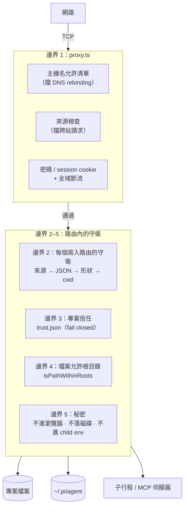
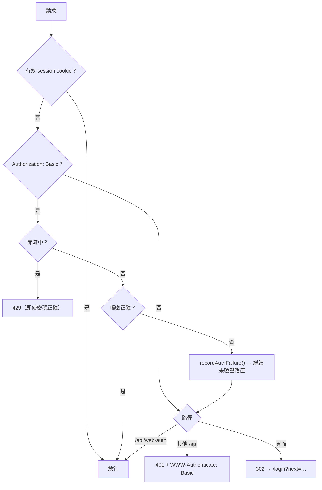

# 06 · 安全模型

Pi Web 會執行一個能讀寫檔案、跑 shell、呼叫模型的 agent。它的安全設計建立在一個
前提上：**它預設是本機工具**，而把它開放給網路需要 operator 明確的選擇。



---

## 1. 瀏覽器密碼（`lib/web-auth.ts`）

密碼只在 `PI_WEB_PASSWORD` 非空時啟用。驗證方式有兩種：

- **Session cookie** `pi_web_session`：`v1.<到期秒>.<32hex nonce>.<64hex HMAC>`，
  HMAC 以密碼為 key、對 `pi-web-session:<payload>` 簽章。有效期 30 天。
- **HTTP Basic**（給 API 客戶端）：帳號固定 `pi`，密碼相同。



- 比對用 `timingSafeEqual` 對 SHA-256 摘要（先雜湊以固定長度，避免長度洩漏）。
- **節流是全域的，不是 per-IP**（`lib/auth-throttle.ts` 的檔頭說明理由）。
  失敗讓所有人的等待加倍：1 秒 → 上限 60 秒；成功**或**閒置 5 分鐘才重置。
  **重置視窗必須長於最大延遲**，否則「等過一次封鎖」就等於重新開始爆破。
  狀態在 `globalThis[Symbol.for("pi-web:auth-throttle")]`，所以 hot reload 後仍在，
  且 `proxy.ts` 與路由共用同一份。
- **`POST /api/web-auth` 與每一個 `Authorization: Basic` 共用同一個計數器**；
  `proxy.ts` 在它的 `/api/web-auth` 豁免**之前**檢查 Basic，所以
  `GET /api/web-auth` 不是一個沒有節流的密碼 oracle。
- **Basic 成功不重置計數器**：Basic 客戶端每個請求都認證一次，每次重置等於給
  交錯嘗試的攻擊者一個全新的短封鎖。被擋住時即使是正確密碼也回 429——
  否則回應本身就會洩漏答案。

**密碼不加密連線。** 綁到非 loopback 位址時，`bin/pi-web.js` 會警告：有密碼時提醒
要用 HTTPS 或可信 VPN；沒有密碼時提醒只能在可信網路使用。

---

## 2. 請求來源（`lib/request-security.ts`）

`proxy.ts` 對每個請求先做兩件事：

### 2.1 主機名允許清單（擋 DNS rebinding）

只信任：

- loopback 名（`localhost`、`*.localhost`）；
- **IP 字面值**（保留區網存取，但因為瀏覽器的 `Host` 標頭會保留字面位址，
  無法被 DNS rebinding 利用）；
- operator 明確設定在 `PI_WEB_HOSTNAME` 或 `PI_WEB_ALLOWED_HOSTS` 的名稱。

主機名解析拒絕任何含空白、`@`、`/`、反斜線的 authority，也要求沒有帳密、路徑、
查詢或 fragment。**`PI_WEB_ALLOWED_HOSTS` 只影響允許清單，不改變綁定位址。**

### 2.2 來源檢查（CSRF）

- `Sec-Fetch-Site: cross-site` 一律拒絕。
- 沒有 `Origin` 也沒有 `Sec-Fetch-Site`（非瀏覽器客戶端）放行。
- 有 `Origin` 時必須等於請求自己的 origin。
- **代理重寫的例外**：有些 relay（例如 Azure Dev Tunnels）會在後端 authority 上
  重寫 `Origin`，只讓 scheme 不同。只有在
  `Sec-Fetch-Site: same-origin`、有 `X-Forwarded-Proto`、且 `Origin` 的 authority
  仍等於 `Host` 時才接受。
- **匯出導覽的例外**：使用者主動點擊導覽到 `/api/sessions/[id]/export`
  （`Sec-Fetch-Mode: navigate` + `Sec-Fetch-Dest: document` + `Sec-Fetch-User: ?1`）
  允許，讓「匯出」能以連結方式開啟。

---

## 3. 檔案存取邊界

### 3.1 允許的根目錄

`/api/files` **不是**通用檔案瀏覽器。允許的根是：

- 所有 pi session 記錄的 `cwd`；
- 它們解析後的主要專案根 `projectRoot`（worktree 會收斂到這裡）；
- 由 `allowFileRoot()` 加入的根——`/api/cwd/validate`、`/api/worktrees`、
  `/api/default-cwd`（建立 `~/pi-cwd/YYYYMMDD` 後由前端走 validate 選取）、
  以及「授權目錄連結」都會呼叫它。

這份集合快取 5 秒（`ALLOWED_ROOTS_TTL_MS`，存在 globalThis 以撐過 hot reload），
所以新建立的 cwd 很快就可讀；`/api/agent/new` 也會在建立 session 後立即
`allowFileRoot(cwd)`，不然新 cwd 底下的檔案請求會 403 最多 5 秒。

### 3.2 唯一的判斷實作

`isPathWithinRoots()`（`lib/path-security.ts`）是**唯一**的邊界實作，
`isFilePathAllowed()` 與 `isExistingFilePathAllowed()` 都走它。

- 兩邊都用 `path.win32` / `path.posix` 重新解析並在 Windows 上做大小寫折疊，
  所以分隔符風格與磁碟機代號大小寫都不影響結果。
- 根目錄只用「斜線正規化」當 Set key 的慣例，**正確性不依賴它**。

### 3.3 `..`、符號連結與 UNC

- **有 `..` 段落的路徑一律拒絕**（`isExistingPathWithinRoots()`）：授權會在跟隨連結
  **之前**收斂 `..`，而檔案系統在**之後**才套用——`root/link/..` 會以 `root` 之名
  授權，卻開到連結目標所在的目錄（根目錄之外）。Query string 與 body 的路徑會
  原樣到達這個檢查。`/api/files/[...path]` 的 URL 解析會丟掉字面的 `..` 段落，
  路由本身另外拒絕段落內被編碼的斜線（`link%2F..%2Fx`）。
- **目錄連結以「它解析到哪裡」授權**：一個在根目錄內、卻指向所有根目錄之外的連結
  會被列出，但它底下的一切被拒。**絕不以字面路徑授權**——一個 commit 進
  clone 的儲存庫的連結就會曝露 `~/.ssh` 或 `/`。
  `checkLinkedDirectoryApproval()` 要求：連結的所在目錄在解析連結後仍在根目錄內，
  且連結仍指向 operator 當時被展示的目標；路由接著 `allowFileRoot()` 該目標
  （授權到伺服器重啟為止，與 `/api/cwd/validate` 給任何目錄的授權相同，
  所以不擴大呼叫者原本到不了的範圍）。目標若包含一個根目錄或家目錄
  （`/`、`~`、專案的父目錄），會標成 `outsideLinkEncloses`，Explorer 會先確認。
- **UNC 路徑**（`\\host\share\dir`）必須能撐過 `/api/files/[...path]` 的往返：
  `encodeFilePathForApi()` 把 `//` 根折進第一個段落（`%2F%2Fhost`），
  `filePathFromApiSegments()` 解回來。**絕不**把 UNC 路徑切成段落再拼回去——
  `\\host\share` 會變成看起來像相對路徑的 `host/share`，而每個允許檢查都會回 403。

### 3.4 讀取單一檔案的特例

`/api/files/...?sessionId=` 也能讀一個位於根目錄之外、但**確切出現在該 session 裡**的
路徑（讓對話裡的檔案連結能開啟）。計入的 entry 是嚴格的清單
（`lib/session-file-references-core.ts`）：

- **計入**：使用者與 assistant 訊息、模型自己的 tool-call 參數（含 MCP 呼叫）、
  以及其他 entry。
- **不計入**：transcript 的 system 訊息、codemode 腳本儲存、`context_edit` 的替代內容、
  以及「非 pi coding tools、非 subagent tools」的任何工具結果——MCP、codemode
  與第三方 extension 會轉送遠端可控的文字。
- 那樣的結果仍會授權它的 `details.fullOutputPath`，以及它透過 `ctx.executeTool()`
  所做的 coding tool 呼叫參數（`nestedCalls`），但**不授權**它嵌套的 MCP 呼叫參數。
- 工具是**依名字**比對的：那份清單必須與 `CODING_TOOL_NAMES` 保持一致。

### 3.5 可見性 ≠ 存取權

`type=list` 省略什麼是**可見性**，從來不是存取權：被隱藏的條目仍可依路徑讀取。

- `lib/file-tree-visibility.ts` 每次列出問一次
  `git check-ignore --no-index --stdin`，再一次 `git ls-files` 判斷哪些被匹配的名字
  其實有被追蹤的路徑（那些仍會列出）。
- **絕不讓 check-ignore 查索引**（每個名字都要掃一次整個索引）。
- `.git` 與 `.DS_Store` 永遠隱藏。固定的名字清單（`node_modules`、`dist`、`build`…）
  只用在 Git 沒有答案的地方：不在工作樹內、git 失敗或逾時（5 秒）、
  以及被忽略目錄內且底下沒有任何被追蹤的東西。
- 兩次 git 呼叫都帶 `-c core.fsmonitor=false`，否則展開一個資料夾會執行
  repository 設定的 hook。
- 顯示被忽略檔案的開關只影響**列出**；搜尋與 `@` 提及不跟隨它。

### 3.6 上傳

- `POST /api/files/<cwd>?type=upload`：單檔上限 **25 MB**、總量 **100 MB**
  （`MAX_UPLOAD_FILE_BYTES` / `MAX_UPLOAD_TOTAL_BYTES`），請求主體上限
  100 MB + 1 MB（`MAX_UPLOAD_REQUEST_BYTES`），以有上限的 form-data 解析讀取。
- 檔名經 `validateUploadFileNames()`：只寫**扁平檔名**，落在 cwd 根目錄
  （瀏覽器不知道被拖放的檔案在磁碟上的位置）。
- Explorer 會先 `upload-check` 讓使用者選覆蓋或跳過；
  **聊天室拖放**直接走 `conflict=skip`，永不覆蓋既有檔案。
- 上傳與拖放**共用同一個客戶端與端點**（`lib/file-upload-client.ts`）；不要新增第二條寫入路徑。

---

## 4. 子行程與環境隔離

`lib/project-command-env.ts` 定義「以專案名義執行的指令」看到的環境：它從
`process.env` 複製後**刪除**宿主執行期變數：

- `PORT`、`NODE_ENV`、任何 `NEXT_*`；
- **`PI_WEB_PASSWORD`**——瀏覽器登入密碼守著這個伺服器，為專案執行（以及讀它輸出的模型）
  完全用不到它。

MCP 的 stdio transport 另外拿一份**消毒過的 env**（`lib/mcp-transport.ts`），
且 `inheritEnv: false`；`PI_WEB_PASSWORD` 永遠不會傳進 MCP 子行程。
一個引用 `PI_WEB_PASSWORD` 的 MCP 條目會被傳輸層**拒絕**（讀取端對應地標示
`web-password`，且永不被開關打開）。

**這兩個環境是不同的東西，不要混用**：host runtime environment（Pi Web 行程自己的）
和 project command environment（專案指令看到的）。

---

## 5. 秘密處理

### 5.1 不進瀏覽器

- `GET /api/mcp` 只送 names，值永不送出；`command` / `args` / `url` 經
  `lib/mcp-secrets.ts` 遮罩（見 [05-config-and-mcp.md §2.1](05-config-and-mcp.md#21-遮罩沒有任何字面值進瀏覽器)）。
- 測試的錯誤與 stderr 先遮罩再截短，所以截斷不會留下半個秘密。
- **MCP undo 只把 token 送到瀏覽器**，永不送條目本身。
- 認證狀態端點永不回傳 raw API key。

### 5.2 不以內容本身當身分

- MCP 狀態以 `configKey` = 條目 `canonicalJson()` 的 **HMAC**（每行程一把隨機 key）
  為身分，不是 JSON 本身（它帶著每個字面值），也不是樸素雜湊
  （一個弱密碼在原本就看得見的條目裡撐不過去）。
- `canonicalJson()` 必須是 total（超過 64 層放標記），否則一個深層嵌套的儲存庫檔案
  會讓整個 session 的同步溢位。

### 5.3 檔案寫入的預設值

- 全域 `mcp.json` 永遠 **0600**（可能含字面秘密），為它建立的資料夾 0700。
- `pi-web-session-state.json` 用 `writePrivateFileAtomicSync()`（0600）。
- 寫入一律「暫存檔 + rename」，讀者只會看到舊檔或新檔。

---

## 6. Extension 與沙箱

- **Codemode 沙箱自我測試**（`checkCodemodeSandbox()`）每行程一次，實際讓 SDK 沙箱
  跑一段腳本；不通過就不提供 codemode（保留 `builtin:codemode` 空 factory，
  所以指名它的設定語意不變）。
- **`extensions:` 的 scope 不是沙箱**：`scopeSubagentExtensions()` 是在 SDK 載入之後
  丟掉其餘 extension，被丟掉的 factory **已經跑過一次**。這是收斂，不是隔離。
- **專案 profile 不得載入受信任與否會影響的東西**：`extensions:` 清單裡的路徑條目
  不載入任何東西——專案 profile 不可以載入「專案信任應該把關」的程式碼。
- 內建 extension 從 SDK factory 重建，且 `replaceable: true, builtin: true`，
  所以 `-builtin:<name>`、專案覆寫、`noExtensions` 的行為與 CLI 一致；
  MCP 在 `PI_WEB_DISABLE_MCP` 或 SDK 內部模組載入失敗時整個關閉，
  **絕不**退回 SDK 自己的 transport。
- Read-only 的 MCP 政策防的是**模型誤用**，不是惡意伺服器：`readOnlyHint` 是伺服器
  自己的說法。

---

## 7. 遠端存取

- **預設只綁 `127.0.0.1`。** 綁到非 loopback 會曝露一個能執行高權限動作的 agent。
- 在可信 LAN 上，用一組長隨機密碼：
  `PI_WEB_PASSWORD='…' pi-web --hostname 0.0.0.0`。
- **密碼不加密連線**。不要用純 HTTP 暴露到網際網路；要透過受信任的反向代理走 HTTPS，
  或走可信 VPN。反向代理若送外部主機名，把該**確切**名稱加進 `PI_WEB_ALLOWED_HOSTS`
  （這個清單不改變綁定位址）。
- 伺服器端模型與 API 請求遵循 `HTTP_PROXY` / `HTTPS_PROXY` / `NO_PROXY`。

---

## 8. 下游整合

### 8.1 Session row 右鍵選單

Electron wrapper 等下游整合可以攔 `pi-web:session-row-contextmenu`（可取消的
browser event），並在會處理時**同步**呼叫 `preventDefault()`：

```js
window.addEventListener("pi-web:session-row-contextmenu", (event) => {
  event.preventDefault();
  const { id, path, cwd, name, clientX, clientY, refresh } = event.detail;
  void openSessionMenu({ id, path, cwd, name, clientX, clientY }).then((changed) => {
    if (changed) refresh();
  });
});
```

沒有 listener 取消時，Pi Web 開自己的選單。這條 hook 是純瀏覽器端，與 pi agent
extension 無關。

### 8.2 Session liveness registry

伺服器端 extension 用 `globalThis[Symbol.for("@agegr/pi-web/session-liveness/v1")]`
阻止自動 idle 驅逐（見 [01-runtime.md §3.5](01-runtime.md#35-session-liveness-lease讓-extension-阻止自動驅逐)）。
Provider 出錯時 **fail safe**（保留該 session）。

---

## 9. 維護這條邊界時的通則

1. **`isPathWithinRoots()` 是檔案邊界的唯一實作**，不要新增第二份。
2. **授權看解析後的路徑，不看字面路徑**；`..` 一律拒絕。
3. **任何寫 `mcp.json` 的地方都走 `lib/mcp-config-file.ts`**；任何寫
   `settings.json` 的地方都走 `lib/global-settings-file.ts`。
4. **任何秘密欄位的分類都走 `lib/mcp-secrets.ts`**，前後端共用，不要各寫一份。
5. **錯誤訊息不引用使用者檔案內容**（`jsonErrorMessage()`），因為 V8 會引用
   未預期 token 附近的文字，那常常是秘密。
6. **寫入路由的守衛順序固定**：來源 → JSON → 形狀 → cwd → 功能層。
7. **測試絕不對真的 `~/.pi/agent` 或正式開發伺服器執行寫入**：把
   `PI_CODING_AGENT_DIR` 指到臨時資料夾（例如
   `app/api/mcp/route-write.test.mjs`、`route-add.test.mjs` 的做法）。
8. **新設定區段要重用 `components/SettingsUi.tsx` 的共用區塊**，並以可見文字說明
   控制項為何不可用（觸控螢幕看不到 tooltip）。
