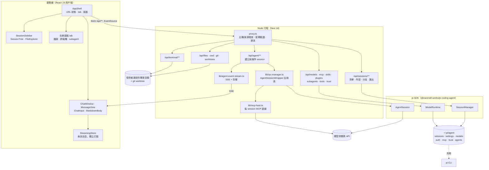
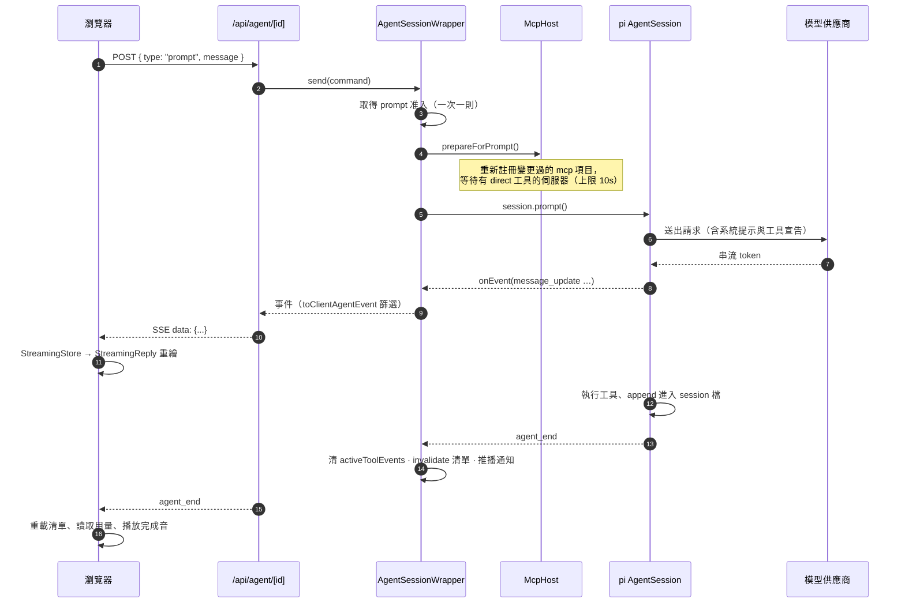

# Pi Web 架構總覽

> 本目錄是 Pi Web 的架構與運作方式說明，寫給想理解整個系統如何接起來的人。
> 逐區的設計決策、踩過的坑與維護規則，仍然在 [`AGENTS.md`](../../AGENTS.md) 與
> [`docs/agents/*.md`](../agents/) 裡；本目錄負責把它們串成一個可以從頭讀到尾的故事，
> 而不是取代它們。
>
> 只想把服務跑起來、停掉或排錯的話，看 **[00-run-locally.md](00-run-locally.md)** 就好，
> 不需要讀完整份架構。

## Pi Web 是什麼

Pi Web 是 [pi coding agent](https://github.com/earendil-works/pi) 的**本機瀏覽器介面**。
它跟 pi CLI 共用同一份設定與 session 檔（`~/.pi/agent`），所以兩邊看到的是同一批對話：

- 在瀏覽器裡瀏覽、續聊、改名、匯出、刪除 pi session；
- 執行 agent 回合（跑模型、跑工具），並即時串流結果；
- 在網頁上設定 provider 登入 / API key、模型、skills、plugins、MCP 伺服器與 subagent；
- 瀏覽專案檔案、看 Git diff、開終端機。

它不是 pi 的替代品，也不是雲端服務：**一個 Pi Web 行程就是一個本機的 agent 伺服器**，
預設只綁 `127.0.0.1:30141`。

## 五個決定整體形狀的約束

讀任何一段程式碼前先記得這幾件事，它們解釋了大部分「為什麼要這樣寫」：

1. **與 pi CLI 共用狀態，不另立格式。**
   Session 檔、`settings.json`、`models.json`、`auth.json`、`mcp.json`、`trust.json`、
   `agents/*.md` 都直接讀寫 pi 的檔案，並且盡量走 pi SDK 的 `SessionManager` /
   `SettingsManager` / `ModelRuntime`。Pi Web 自己的 UI 狀態（釘選、封存、專案順序）
   放在獨立的 `pi-web-session-state.json`，**絕不寫進 `.jsonl`**。

2. **一個長命行程服務很多 session。**
   這是網頁伺服器，跟「一個 CLI 行程一個 session」不同。因此多了
   wrapper 註冊表、idle 逾時、MCP 伺服器延後連線與閒置釋放、SSE 背壓、
   清單快取這些 CLI 不需要的機制。

3. **擴充套件必須跟 pi CLI 行為一致。**
   為 pi CLI 寫的 extension，放進 Pi Web 也要能跑。顯示層的問題在網頁前端修，
   不可以為了前端方便而新增 pi-web 專屬的 extension API（`ctx.ui.*` 選項、
   `extension_ui_request` 欄位）。pi TUI（`@earendil-works/pi-tui`）是語意的參考實作。

4. **檔案系統存取是一條安全邊界。**
   `/api/files` 不是通用檔案瀏覽器；只有「session 用過的 cwd / 專案根目錄」加上
   明確授權過的根目錄可以讀。詳見 [06-security.md](06-security.md)。

5. **伺服器行程與專案命令環境分離。**
   在專案裡跑的 shell 指令拿到的環境變數，會清掉 `PORT`、`NODE_ENV`、`NEXT_*`、
   `PI_WEB_PASSWORD` 等宿主執行期變數（見 `lib/project-command-env.ts`）。

## 系統全貌



## 一次 prompt 的端到端流程



## 三個執行期角色

| 角色 | 進入點 | 說明 |
| --- | --- | --- |
| **CLI 啟動器** | `bin/pi-web.js` | 檢查 Node 版本、解析選項、旋轉 preview secret、spawn `next start`、登記 run record、開瀏覽器；也提供 `version` / `status` / `stop` / `open` / `update` 子命令。 |
| **Next 伺服器** | `app/**`（route handlers） | 所有 `/api/**`、`proxy.ts` 中介、SSE 串流。開發時是 `next dev`（Turbopack），發佈時是 `next build`（webpack）+ `next start`。 |
| **pi SDK 執行期** | `lib/rpc-manager.ts` 起 | 在行程內建立 `AgentSession`，一個 session id 一個 wrapper，掛在 `globalThis` 上以撐過 hot reload。 |

前端只有一個進入點：`app/page.tsx` → `I18nProvider` → `AppShell`。整個 `/` 在用戶端渲染。

## 資料放在哪裡

| 路徑 | 內容 | 誰寫 |
| --- | --- | --- |
| `~/.pi/agent/sessions/<encoded-cwd>/<timestamp>_<uuid>.jsonl` | pi session 逐行紀錄（JSONL） | pi、pi-web（fork / 改名 / 工具選擇） |
| `~/.pi/agent/settings.json` | 預設模型、`defaultTools`、`codemode.*`、`enabledModels`、shell 設定 | pi、pi-web |
| `<project>/.pi/settings.json` | 專案覆寫（會取代全域值） | 使用者 |
| `~/.pi/agent/models.json` | 自訂 provider / 模型 | pi-web Settings › Models |
| `~/.pi/agent/models-store.json` | pi.dev catalog 快取 | SDK、pi CLI |
| `~/.pi/agent/auth.json` | provider 憑證（OAuth / API key） | pi、pi-web |
| `~/.pi/agent/mcp.json` / `<project>/.pi/mcp.json` | MCP 伺服器設定 | pi、pi-web |
| `~/.pi/agent/mcp-auth.json` | MCP OAuth tokens 與 client 註冊 | SDK |
| `~/.pi/agent/trust.json` | 專案信任決策 | pi、pi-web |
| `~/.pi/agent/agents/settings.json` | 內建 subagent 開關與 `maxConcurrent` | pi-web |
| `~/.pi/agent/agents/*.md` / `<project>/.pi/agents/*.md` | subagent profile | pi-web、其他 runtime |
| `~/.pi/agent/pi-web-session-state.json` | **Pi Web 專屬**：釘選、封存、專案順序與顯示名稱 | pi-web（唯讀於 pi） |

`PI_CODING_AGENT_DIR` 可以把 `~/.pi/agent` 換到別的位置；瀏覽器端的偏好（分頁、
字型、音效、未讀）存在 `localStorage`，terminal 分頁存在 `sessionStorage`。

## 名詞

| 詞 | 意思 |
| --- | --- |
| **wrapper** | `AgentSessionWrapper`：包住一個 pi `AgentSession`，加上事件轉送、idle 逾時、MCP、extension UI 佇列等。 |
| **family** | 一個 session 加上它的 subagent session（後者摺疊進前者在側邊欄的那一列）。 |
| **fork** | 側邊欄的「Fork」＝在磁碟上把目前分支複製成新 `.jsonl`（`parentSession` 指向來源），不建立 runtime。 |
| **branch / navigate_tree** | 同一個檔案內的分支切換（「Edit from here」）。 |
| **Chat only** | 明確空的工具選擇；不載入 extensions / skills / prompts / themes / pi 基礎系統提示。 |
| **preset** | 工具預設（None / Read-only / Default / Full / From settings）。 |
| **exposure** | 工具對模型的可見方式：`direct`、`codemode`、`deferred`、`hidden`。 |
| **host runtime** | Pi Web 伺服器自己的行程環境。 |
| **project command environment** | 以專案名義執行的指令所看到的環境（已消毒）。 |

## 閱讀順序

要先跑起來（可選）：**[00-run-locally.md](00-run-locally.md)** —— 本機執行手冊，
跑起來、停止、環境變數、疑難排解。不是架構說明。

1. **[01-runtime.md](01-runtime.md)** — 行程怎麼起來、AgentSession 生命週期、SSE、session 檔與快取。
2. **[02-api.md](02-api.md)** — `app/api/**` 全部路由與 agent 命令的目錄。
3. **[03-frontend.md](03-frontend.md)** — AppShell、hooks、串流、訊息渲染、側邊欄與右側面板。
4. **[04-agent-and-tools.md](04-agent-and-tools.md)** — 工具選擇、內建 extension、subagent、extension 相容層。
5. **[05-config-and-mcp.md](05-config-and-mcp.md)** — 模型與登入、MCP、skills、plugins、專案信任。
6. **[06-security.md](06-security.md)** — 密碼驗證、請求來源檢查、檔案邊界與秘密處理。

## 開發、測試與 demo

> 完整的手冊（停止方式、環境變數、疑難排解、WSL、本機實測紀錄）在
> **[00-run-locally.md](00-run-locally.md)**。

```bash
npm run dev                 # http://127.0.0.1:30141（Turbopack）
npm test                    # node --test，各層的 *.test.mjs
node_modules/.bin/tsc --noEmit
npm run lint
npm run test:terminal       # 需要 npx playwright install chromium
npm run test:e2e
```

- **開發時不要跑 `next build`**：它會改寫 `.next/`，跟正在跑的 `npm run dev` 打架。
  dev 與 build 使用不同的 bundler，遇到 `Module ... factory is not available` 這類
  overlay 通常只是那個分頁的 HMR 圖過期，先重新載入頁面再判斷。
- `demo/` 是把 `components/`、`hooks/`、`lib/` 複製一份，接上 in-browser mock 的
  靜態版，發佈到 GitHub Pages；詳見 [`demo/README.md`](../../demo/README.md)。
- `e2e/` 是用 Playwright 驅動真實伺服器（或 mock）的瀏覽器測試；詳見
  [`e2e/README.md`](../../e2e/README.md)。
- 其他主題文件：[`docs/terminal.md`](../terminal.md)、[`docs/worktrees.md`](../worktrees.md)、
  [`docs/i18n.md`](../i18n.md)、[`docs/release.md`](../release.md)、
  [`docs/adr/`](../adr/)（架構決策紀錄）。
